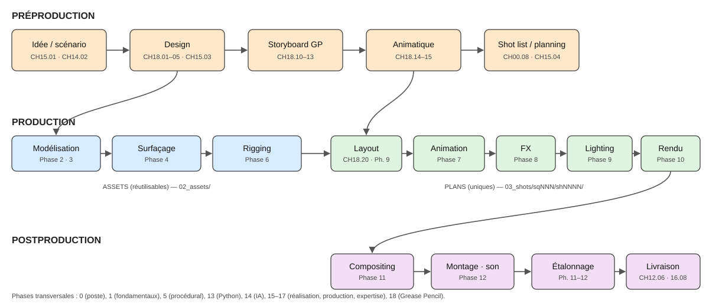

# CH00.08 — Cours théorique : le pipeline d'un film d'animation 3D

## 1. Trois grandes périodes
| Période | Question | Livrables | Coût d'une modification |
|---|---|---|---|
| **Préproduction** | *Quoi* raconter, *comment* le montrer ? | Scénario, design, storyboard, animatique, listes d'assets et de plans, planning | Très faible (on redessine) |
| **Production** | Fabriquer les images | Assets (modèles, matériaux, rigs), plans (layout, animation, FX, lighting, rendu) | Élevé (heures de travail par plan) |
| **Postproduction** | Finir le film | Compositing, montage, son, étalonnage, masters | Moyen à élevé |

**Règle de base : on résout les problèmes le plus tôt possible.** Couper un plan dans
l'animatique coûte une minute ; le couper après l'animation et l'éclairage coûte des
semaines. C'est pourquoi l'animatique (phase 18) est **obligatoire** avant toute 3D dans
les projets de l'académie.

## 2. Assets et plans : les deux chaînes
- Les **assets** (personnages, décors, accessoires) sont fabriqués une fois et réutilisés :
  modélisation → surfaçage (UV, textures, matériaux) → rigging (si animé).
- Les **plans** (*shots*) assemblent les assets : layout (caméra, placement) → animation →
  FX (simulations) → lighting → rendu → compositing.
Un plan n'utilise jamais une **copie** d'un asset mais un **lien** vers le fichier de l'asset
(*link* + *library override*, phase 16) : corriger l'asset corrige tous les plans.

## 3. Le plan, unité de travail
Un plan = un code (`sq010_sh0040`), une durée en images, une caméra, une liste de
personnages et d'assets, un statut. Toute la production est **suivie plan par plan** :
tableau des plans × étapes, chaque case passant de *todo* à *done*.
| Plan | Board | Anim. | Layout | Anim | FX | Light | Rendu | Comp |
|---|---|---|---|---|---|---|---|---|
| sq010_sh0010 | ✔ | ✔ | ✔ | — | — | en cours | | |
Le fichier CSV de shot list de ce chapitre est la forme la plus simple de ce suivi
(CH16.02 utilise de vrais outils, comme Kitsu).

## 4. Les départements (et ce que vous apprendrez)
| Département | Rôle | Phase BCMA |
|---|---|---|
| Story / storyboard | Raconter en images, rythme | 18, 15 |
| Art department | Style, design, color script | 18, 15 |
| Modeling | Formes 3D | 2, 3 |
| Surfacing / lookdev | Matériaux, textures | 4 |
| Rigging | Squelettes et contrôleurs | 6 |
| Layout | Caméras, mise en place des plans | 9, 18 |
| Animation | Jeu d'acteur, mouvements | 7 |
| FX | Simulations | 8 |
| Lighting | Éclairage, ambiance | 9 |
| Rendering / TD | Rendu, optimisation, outils | 10, 13 |
| Compositing | Assemblage final de l'image | 11 |
| Editorial / son | Montage, son | 12 |
| Production | Planning, budget, suivi | 15, 16 |
| Pipeline / TD | Outils, automatisation | 13, 17 |

Seul, vous tiendrez tous ces rôles : d'où l'importance des conventions et de
l'automatisation, qui remplacent la coordination d'une équipe.

## 5. Les passerelles de l'académie
La chaîne **Scénario → Storyboard GP → Animatique → Layout 3D → Blocking → Animation →
Lighting → Rendu → Compositing → Montage final** est décrite étape par étape (livrables,
conventions, scripts de passage) dans
[DOCUMENTATION/PIPELINE_BRIDGES.md](../../DOCUMENTATION/PIPELINE_BRIDGES.md).

## 6. Valeurs de plans (vocabulaire de la shot list)
| Code | Nom | Cadre |
|---|---|---|
| EWS | Extreme Wide Shot (plan de très grand ensemble) | Le lieu, personnages minuscules |
| WS | Wide Shot (plan d'ensemble) | Personnages entiers dans le décor |
| FS | Full Shot (plan en pied) | Personnage de la tête aux pieds |
| MS | Medium Shot (plan taille / américain) | Taille ou cuisses |
| MCU | Medium Close-Up (plan rapproché poitrine) | Poitrine |
| CU | Close-Up (gros plan) | Visage |
| ECU | Extreme Close-Up (très gros plan) | Détail (œil, main) |
| OTS | Over The Shoulder (amorce épaule) | Dialogue |
| POV | Point of View (plan subjectif) | Ce que voit le personnage |
| INSERT | Insert | Objet important |
(Approfondi en CH18.10 et phase 9.)

## 7. Estimer : premières notions
Durée × complexité = charge. Ordres de grandeur pour un artiste seul et entraîné, style
simple : storyboard 15–30 min par plan ; animatique 10 min par plan ; layout 30–60 min ;
animation de personnage 2–8 h par seconde selon la qualité ; lighting 1–3 h par plan
(par séquence avec réutilisation). Ces chiffres varient énormément : ils serviront à
construire vos budgets en phases 15–16, **puis à être corrigés par vos propres mesures**.
