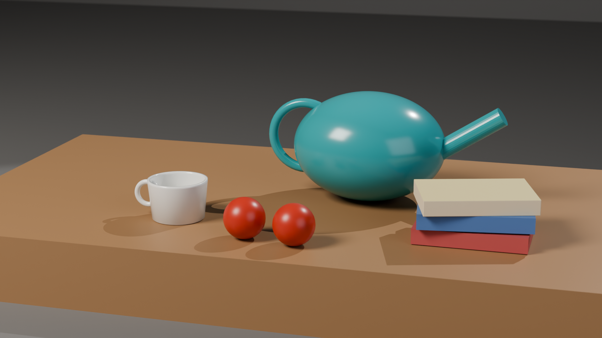

# Projet de phase P1 — « Nature morte »

**Phase :** 1 — Fondamentaux absolus · **Durée estimée :** 6 à 10 h · **Évalue :** C01.01 → C01.14

## Brief
Réalisez une **nature morte** originale (un coin de bureau, une table de cuisine, un établi
d'artisan, un autel de magicien…) entièrement construite avec les outils de la phase 1 :
primitives, Edit Mode, modificateurs, matériaux simples, une caméra composée, un éclairage
trois points, et livrez **deux rendus** (EEVEE et Cycles).

## Version courte

Pour le parcours débutant, ouvrez le fichier de la caisse et enregistrez-le sous `nature_morte_v001.blend`. Placez la caisse sur une table simple, puis ajoutez deux objets de formes ou de hauteurs différentes. Choisissez l’objet à mettre en avant, puis placez une caméra et une source principale. Un seul rendu suffit pour ce jalon.

1. En vue caméra, déplacez un objet qui masque la silhouette du sujet. Gardez une marge autour du cadre.
2. Dans *Output Properties*, réglez 768 × 768 à 100 %. Rendez en EEVEE et enregistrez le PNG. Gardez le `.blend` et le PNG ensemble.
3. Rouvrez votre `.blend` puis enregistrez une copie. Sans guide, essayez un autre cadrage et justifiez celui que vous retenez en une phrase.

Validez le jalon lorsque les deux fichiers se rouvrent, que le sujet principal se repère facilement et que vous savez refaire le cadrage. La grille ci-dessous sert à relire la scène. Gardez le projet complet pour une séance de consolidation.

## Contraintes techniques (vérifiées par `validate_p1.py`)
1. Fichier `PROJECTS/p1_nature_morte/p1_nature_morte_<prenom>_v0NN.blend` (nommage BCMA).
2. Collections : `SET`, `PROPS`, `LIGHTS`, `CAMERAS` (+ `HELPERS` hors rendu si besoin) ; aucun
   objet en vrac ; conventions de noms respectées (`bcma_naming_check.py` sans problème).
3. Au moins **8 maillages** dans `PROPS`, dont au moins deux objets partageant un même maillage, un objet avec
   **≥ 2 modificateurs**, 1 objet avec **≥ 2 matériaux** (affectation par faces).
4. Échelles appliquées (1, 1, 1) sur tous les maillages sans parent.
5. Une caméra active `CAM_…` avec une focale entre 35 et 100 mm, profondeur de champ activée.
6. Au moins 3 lumières (key/fill/rim) ; monde à intensité ≤ 0,5.
7. Rendus `renders/p1_cycles.png` et `renders/p1_eevee.png` (1920 × 1080) à côté du `.blend`.

## Atelier en trois séances

1. **À l’écran, la silhouette se comprend déjà.** En mode Objet, créez le support et
   placez les volumes provisoires. Depuis la vue caméra (`Numpad 0`), repérez l’objet
   principal et limitez les superpositions qui masquent sa forme. Essayez deux hauteurs
   de caméra à focale fixe. Gardez une capture de chaque proposition et sauvegardez `v001`.
2. **Les détails restent contrôlables.** Reprenez votre composition et modelez les
   accessoires. Appliquez l’échelle avant d’ajouter un biseau ou de créer les copies liées.
   Créez une paire d’objets répétitifs avec `Alt+D`. Passez en mode Édition sur l’un et
   vérifiez qu’une retouche du maillage atteint aussi l’autre. Annulez cette retouche
   d’essai. Pour un livre, ajoutez un second matériau dans *Material Properties*, sélectionnez
   uniquement les faces latérales en mode Édition et cliquez sur *Assign*. Contrôlez en aperçu
   des matériaux que la couverture et les pages restent distinctes. Sauvegardez `v002`.
3. **La scène se livre et se compare.** Ajoutez les trois sources une à une. Faites un
   aperçu de la lumière principale seule, puis du remplissage et du contre-jour. Si le
   côté sombre devient aussi clair que le côté éclairé, baissez le remplissage. Pour
   comparer les moteurs, gardez le cadre, la vue colorimétrique et l’éclairage fixes.
   Faites d’abord un essai à 25 %, puis revenez à 100 % avant les deux rendus définitifs.
   Vérifiez les PNG enregistrés à côté du `.blend` et sauvegardez `v003`.

## Corrigé à inspecter

Ouvrez la [scène de référence](REFERENCE/p1_nature_morte_reference.blend) après votre
premier blocking. Dans *Object Data*, comparez les données des deux pommes. Dans le
livre supérieur, inspectez l’affectation des pages et l’ordre des modificateurs.
Réglez ensuite votre propre version en vous servant de ce que vous avez observé.



Comparez avec le [rendu de la même scène dans EEVEE](REFERENCE/renders/p1_eevee.png).
Repérez les différences aux contacts entre objets, puis vérifiez quelles surfaces
captent les reflets. Le correcteur vérifie la résolution des fichiers et les réglages
de la scène. La comparaison visuelle reste un élément de la grille d’évaluation.

Pour régénérer la référence, ouvrez le corrigé de CH01.14 avec Blender 5.3 et lancez
`build_reference.py` via `--python-exit-code 1 --python`. Le script écrit uniquement
dans `REFERENCE` du projet P1.

## Vérification
```powershell
& "C:\Program Files\Blender Foundation\Blender 5.3\blender.exe" -b --factory-startup `
  "PROJECTS\p1_nature_morte\p1_nature_morte_<prenom>_v001.blend" `
  --python-exit-code 1 --python "01_FUNDAMENTALS\PROJECT_P1\validate_p1.py"
```

Depuis la racine du cours, `python 01_FUNDAMENTALS/PROJECT_P1/test_p1.py` vérifie la
référence et deux variantes fautives. Les variantes sont préparées dans des copies temporaires.

## Grille d'évaluation (sur 100)
| Critère | Points | Comment l'évaluer |
|---|---|---|
| Contraintes techniques (correcteur) | 30 | Score du correcteur ramené sur 30 |
| Composition (tiers, lisibilité, profondeur) | 15 | Le regard sait où aller en 2 secondes |
| Éclairage (formes lisibles, ratio maîtrisé, pas de zones brûlées) | 15 | Vue *False Color* |
| Matériaux crédibles (métal/non-métal, rugosités variées) | 15 | Au moins 4 matières distinctes |
| Qualité de modélisation (formes propres, biseaux, pas d'interpénétration) | 15 | Inspection rapprochée |
| Autonomie et vitesse (journal de temps, aucun tutoriel suivi pas à pas) | 10 | Journal dans PROGRESS.md |
**Phase 1 validée si ≥ 70/100** et tous les quiz de la phase ≥ 80 %.

## Livrables
- Le `.blend` final et ses versions intermédiaires (`v001`, `v002`…).
- Les deux rendus, plus une planche « avant/après » (premier jet vs final) dans `PORTFOLIO/p1/`.
- Un court texte (5–10 lignes) : intention, choix de focale et d'éclairage, difficultés.

## Conseils de méthode
1. **Références d'abord** (15 min) : 3 photos de natures mortes dont vous aimez la lumière.
2. **Blocking** en cubes et cylindres (30 min) : composition et cadrage avant tout détail.
3. Formes et modificateurs, puis matériaux, puis lumière, puis rendu : toujours du général au
   particulier.
4. `Ctrl+Alt+S` à chaque étape (versions), sauvegarde 3-2-1 en fin de séance.
