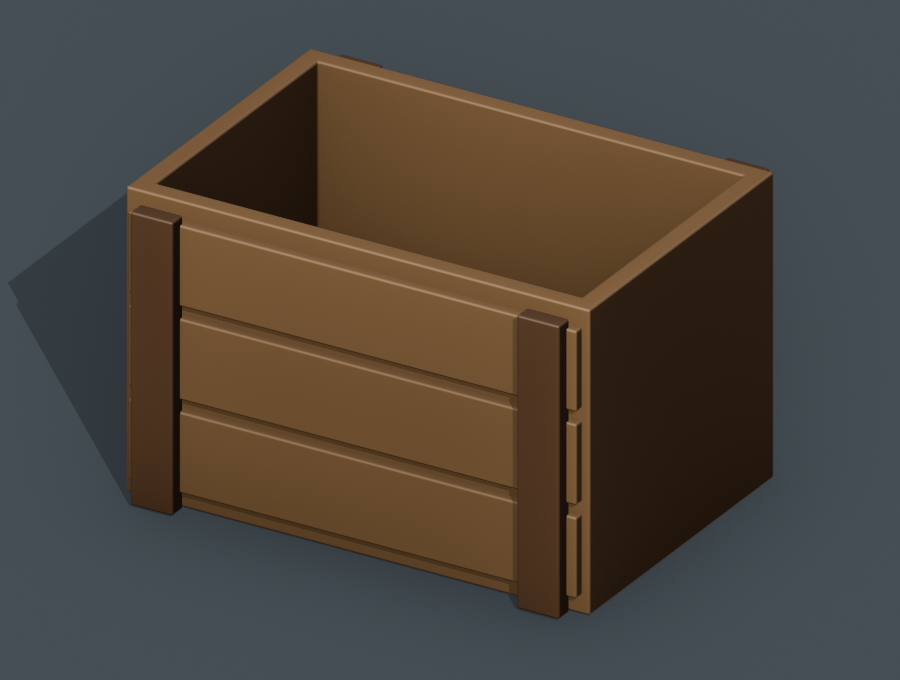
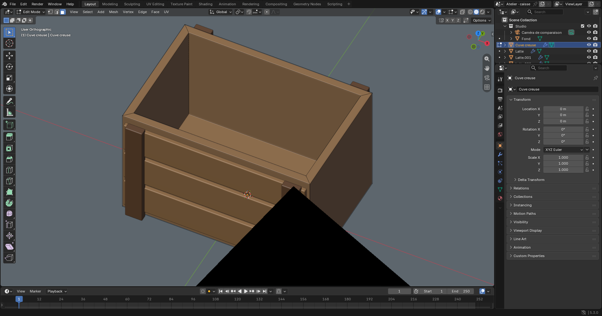

# 1. Caisse en bois

**Temps indicatif** 60–90 min.

## Objectif

Modéliser une caisse ouverte, lisible par son rebord et ses planches.

## Résultat attendu

Une caisse de 0,60 × 0,40 × 0,38 m avec fond, quatre parois et renforts. Le vide doit rester visible.

Ce visuel est un rendu de comparaison réalisé dans Blender. Le résultat se contrôle également en vue Solid et en filaire.

[Scène Blender de comparaison](assets/caisse.blend)

## Outils

`Tab` · `S` · `I` · `E` · `Ctrl+B` · `Shift+D` · `Shift+N`. Raccourcis de la keymap Blender par défaut.

## Erreurs fréquentes

Si la caisse paraît pleine, contrôlez l’inset et le sens de l’extrusion. Si le biseau varie, appliquez l’échelle avant le modificateur.

## Tutoriel dans Blender

### bloc — Bloquer l’encombrement

Dans un nouveau fichier métrique, ajoutez un cube. Dans `N` → Item, réglez Dimensions à 0,60 / 0,40 / 0,38 m. `Ctrl+A` → Scale fige l’échelle tout en conservant la taille.

**Vérification** Mesurez dans `N`. Les trois valeurs Scale doivent valoir 1.

### creux — Créer la cavité

Regardez la largeur du rebord et les faces de la paroi intérieure avant d’ajouter des biseaux.

`Tab`, `3`, sélectionnez seulement le dessus. `I .025` réserve un rebord, puis `E -0.34` descend le fond et laisse 0,04 m de matière.

**Vérification** En trois-quarts, voyez les quatre parois et le fond. L’enceinte est ouverte en haut mais le maillage a une épaisseur.

### planches — Donner une lecture de bois assemblé

En Object Mode, créez deux lattes horizontales fines en façade et deux renforts verticaux plus épais. Dupliquez par `Shift+D`, puis contraignez en X ou Y. Laissez une rainure lisible entre les lattes.

**Vérification** En profil, la latte touche la paroi. Aucun renfort ne traverse le volume utile.

### biseau — Séparer les reflets

Biseautez des arêtes de renfort par `Ctrl+B` en Edit Mode, ou ajoutez un Bevel de 2 mm en Object Mode. Deux segments suffisent au plan moyen. Recalculez les normales du corps avec `A`, `Shift+N`.

**Vérification** En vue Solid, le rebord reste fin et les arêtes accrochent la lumière.

### preuve — Livrer une variante

Sauvegardez `caisse_v001.blend`, puis changez la largeur dans `caisse_v002.blend`. Vérifiez le rebord et déplacez les renforts en conséquence.

**Vérification** Montrez une vue ouverte et une vue de dessous. Le fond existe dans les deux versions.

