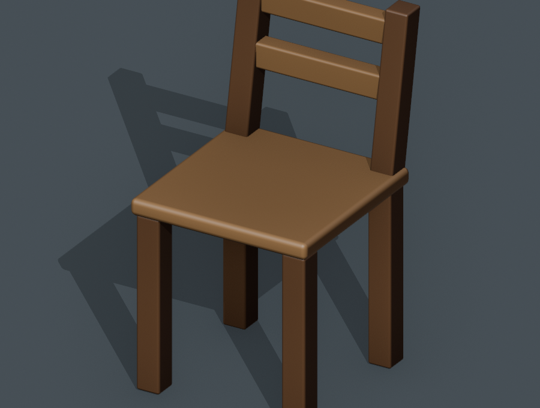

# 3. Chaise

**Temps indicatif** 2–3 h.

## Objectif

Construire un dossier et une assise à l’échelle d’un adulte.

## Résultat attendu

Une chaise avec assise à 0,45 m, dossier incliné et quatre appuis lisibles.

Ce visuel est un rendu de comparaison réalisé dans Blender. Le résultat se contrôle également en vue Solid et en filaire.

[Scène Blender de comparaison](assets/chaise.blend)

## Outils

`G` · `R` · `S` · `Shift+D` · `E` · `Ctrl+R` · `Ctrl+B`. Raccourcis de la keymap Blender par défaut.

## Erreurs fréquentes

Inclinez le dossier autour de sa base ou ajustez son sommet en Edit Mode. Une rotation autour de son centre peut le séparer de l’assise.

## Tutoriel dans Blender

### assise — Construire l’assise

Placez un plateau de 0,43 × 0,43 × 0,04 m à Z=0,43 m. Réservez le sens de l’avant (−Y). Créez deux pieds avant, chacun haut de 0,41 m.

**Vérification** L’assise culmine à 0,45 m et les pieds atteignent son dessous.

### montants — Faire monter les pieds arrière dans le dossier

Dupliquez les pieds avant vers +Y. Sur les deux montants arrière, sélectionnez la face du haut et extrudez avec `E Z .38`. En vue profil, reculez les sommets hauts par `G Y .07`.

**Vérification** Le dossier incliné reste connecté aux montants. La base ne glisse pas.

### dossier — Relier les montants

Ajoutez deux lattes horizontales et tournez-les autour de X si nécessaire. Pour alléger un montant, ajoutez une boucle `Ctrl+R` et ajustez la largeur au-dessus de l’assise.

**Vérification** Les traverses touchent les montants. Vérifiez les intersections depuis le dessus.

### finition — Valider l’usage

Biseautez les arêtes, mesurez les quatre appuis et comparez au modèle de table. Variante : modifier l’inclinaison du dossier et replacer ses lattes.

**Vérification** En silhouette, la chaise tient et son dossier se distingue.

