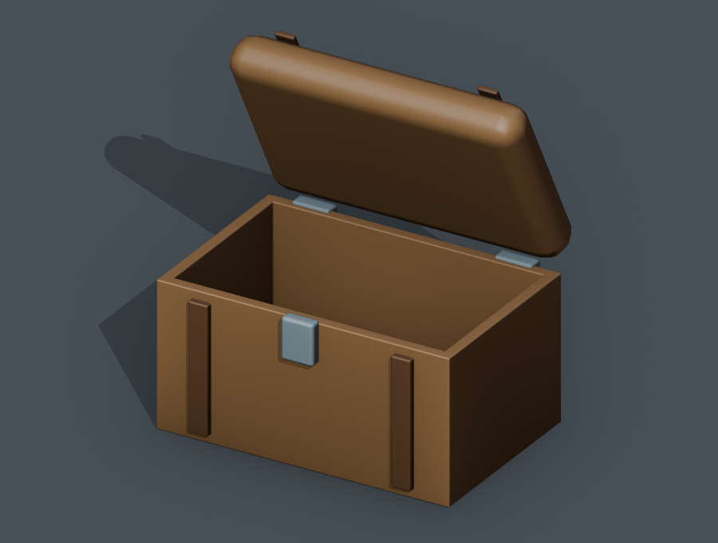

# 5. Coffre ouvrant

**Temps indicatif** 2–3 h.

## Objectif

Définir une coque, un couvercle articulable et des contraintes d’assemblage.

## Résultat attendu

Un coffre de 0,65 × 0,42 m, avec cavité, couvercle et deux poses de vérification.

Ce visuel est un rendu de comparaison réalisé dans Blender. Le résultat se contrôle également en vue Solid et en filaire.

[Scène Blender avec pivot du couvercle](assets/coffre.blend)

## Outils

`I` · `E` · `Ctrl+R` · `O` · `Ctrl+B` · `Shift+S` · `R`. Raccourcis de la keymap Blender par défaut.

## Erreurs fréquentes

Si le couvercle traverse les parois en rotation, vérifiez son origine et l’espace autour des charnières.

## Tutoriel dans Blender

### cuve — Construire la cuve

À partir d’un cube dimensionné à 0,65 × 0,42 × 0,32 m, appliquez l’échelle. Sélectionnez le dessus : `I .025`, puis `E -0.28`. Biseautez les arêtes exposées.

**Vérification** Le coffre ouvert a un fond et un rebord régulier.

### couvercle — Façonner un couvercle séparé

Ajoutez un volume de mêmes longueur et largeur, haut de 0,10 m. Avec `Ctrl+R`, ajoutez deux boucles parallèles. Ajustez les rangées hautes en profil. Testez `O` sur la rangée centrale pour arrondir avec un faible rayon.

**Vérification** Le couvercle repose sur le rebord et son profil n’est pas parfaitement rectangulaire.

### pivot — Placer le pivot de la charnière

Sélectionnez la rangée arrière sous le couvercle en Edit Mode. `Shift+S` → Cursor to Selected. Revenez en Object Mode, Object → Set Origin → Origin to 3D Cursor.

**Vérification** En `R X`, le couvercle pivote autour du bord arrière.

### pose — Vérifier ouvert et fermé

Enregistrez une pose fermée et testez une ouverture d’environ 70°. Ajoutez deux charnières et une attache visibles. Variante : réduire la hauteur et repositionner le pivot.

**Vérification** Deux vues du coffre montrent qu’aucune pièce ne traverse la cuve dans les poses de contrôle.

