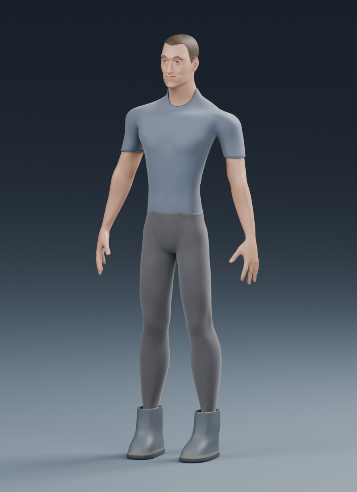

# 9. Corps humain complet

**Temps indicatif** 5–9 h.

## Objectif

Assembler les régions du corps dans une cage continue, prête pour un test de pose.

## Résultat attendu

Un humain neutre avec des proportions cohérentes dans deux vues et un premier coude ou genou testé.

Ce visuel est un rendu de comparaison réalisé dans Blender. Le résultat se contrôle également en vue Solid et en filaire.

[Cage d’apprentissage en .blend](assets/cage_humain.blend) · [Personnage anatomique plus avancé](../../PROPOSITIONS/RECONSTRUCTION_2_VUES/personnage_final_pieds_ajustes.blend)

## Outils

`Mirror` · `E` · `Ctrl+R` · `M` · `O` · `Numpad 1/3`. Raccourcis de la keymap Blender par défaut.

## Erreurs fréquentes

Comparez après chaque région. Des membres construits comme des cylindres séparés cachent les transitions d’épaule et d’aine.

## Tutoriel dans Blender

### base — Démarrer par bassin et cage thoracique

Alignez vos gabarits puis bloquez un demi-bassin, extrudez les sections de taille et du torse. Conservez une bande de quads et des faces de sortie pour épaule et jambe.

**Vérification** Sur les deux vues, les largeurs et épaisseurs du bassin et du thorax sont distinctes.

### membres — Construire les membres

Extrudez depuis l’épaule vers le coude, puis le poignet. Depuis le bassin, créez les sections hanche, genou et cheville. Donnez des mains et des pieds simplifiés, puis marquez le plan de la paume et la semelle.

**Vérification** Les articulations correspondent aux repères de face et de profil.

### tete — Raccorder le cou, nettoyer les jonctions

Depuis l’ouverture du haut du torse, extrudez le cou puis raccordez la tête avec Bridge Edge Loops si elle a été travaillée à part. Contrôlez le même nombre de sommets aux interfaces. Voir [l’atelier détaillé du corps](hum-corps.md).

**Vérification** Aucune arête de bord involontaire autour du cou. Vérifiez Merge et Clipping.

### preuve — Déformer le coude et le genou

Montez un rig simplifié d’après [la leçon de rigging](hum-rig.md). Pliez le coude puis le genou et réajustez une boucle ou un groupe de poids. Sauvegardez pose neutre et pose de vérification.

**Vérification** Le volume est reconnaissable dans les deux poses. L’illustration montre un asset avancé de comparaison.

