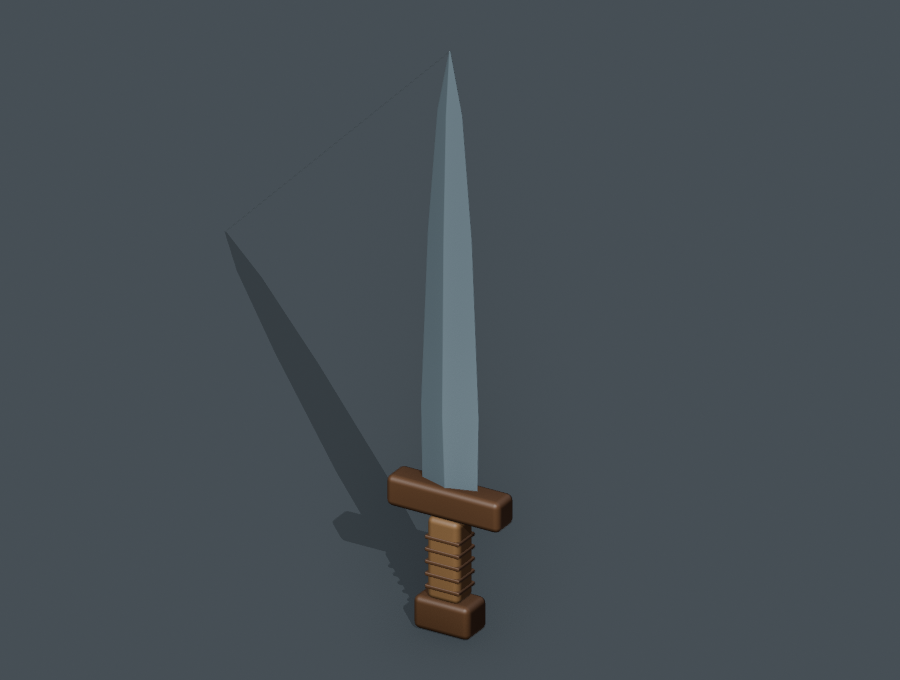

# 4. Accessoire d’épée stylisée

**Temps indicatif** 2–3 h.

## Objectif

Modéliser un accessoire 3D fictif avec symétrie et reflets lisibles.

## Résultat attendu

Une lame stylisée, une garde, une poignée et un pommeau, avec une cage inspectable.

Ce visuel est un rendu de comparaison réalisé dans Blender. Le résultat se contrôle également en vue Solid et en filaire.

[Scène Blender avec Mirror éditable](assets/epee.blend)

## Outils

`Tab` · `Ctrl+R` · `E` · `M` · `Ctrl+B` · `Mirror` · `Shift+N`. Raccourcis de la keymap Blender par défaut.

## Erreurs fréquentes

Gardez l’origine sur X=0 avant Mirror. Une pointe peut se fermer avec `M` → At Center, mais évitez de rabattre des rangées entières de sommets.

## Tutoriel dans Blender

### cage — Construire la moitié de la lame

À partir d’un cube, donnez à la lame une largeur visible en face et de l’épaisseur en profil. Coupez au milieu avec `Ctrl+R`, supprimez la moitié X négative, ajoutez Mirror X avec Merge et Clipping.

**Vérification** En filaire, une seule moitié est éditable et la surface évaluée reste symétrique.

### pointe — Placer les sections jusqu’à la pointe

Extrudez une section à mi-hauteur puis une près de la pointe. Réduisez la largeur par `S X`. Fermez l’extrémité proprement et gardez un relief central en décalant les sommets sur Y.

**Vérification** En profil la lame est épaisse. En face, son axe reste droit.

### poignee — Séparer les pièces de l’accessoire

Ajoutez garde, poignée et pommeau comme objets séparés. Orientez les pièces autour de l’axe de la lame et utilisez des biseaux différents pour la garde et le pommeau.

**Vérification** Les assemblages touchent sans décalage visible. La poignée se distingue dans la silhouette.

### lecture — Valider et créer une deuxième silhouette

Faites deux vues sous éclairage rasant, puis changez la forme de la garde sans toucher à la lame.

**Vérification** Le reflet suit la longueur et les deux silhouettes se distinguent de loin.

