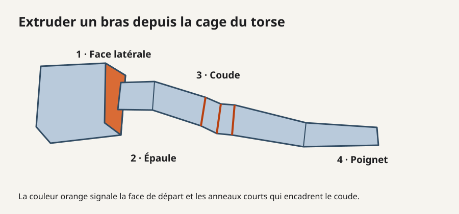
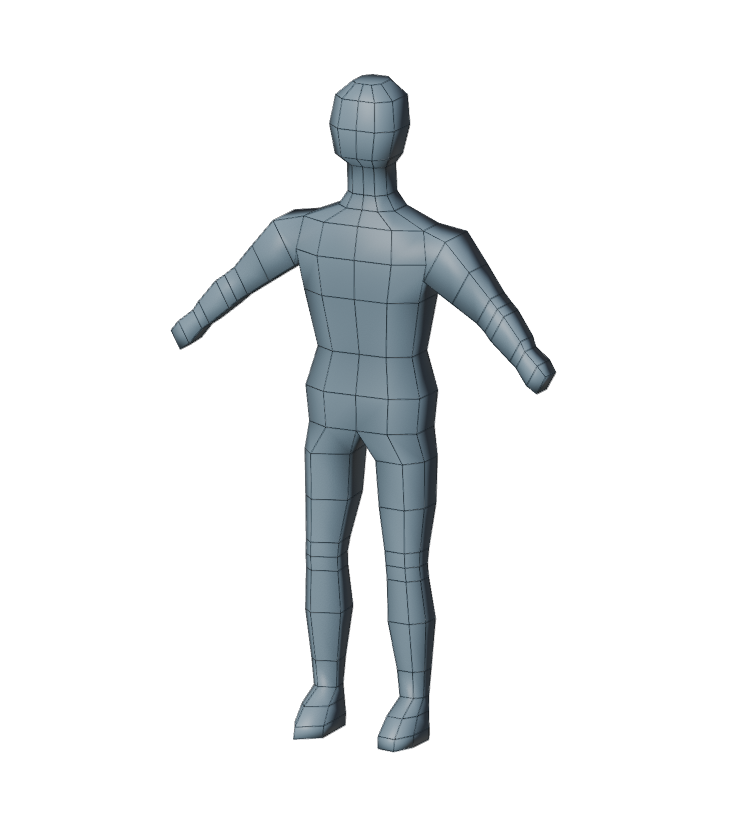
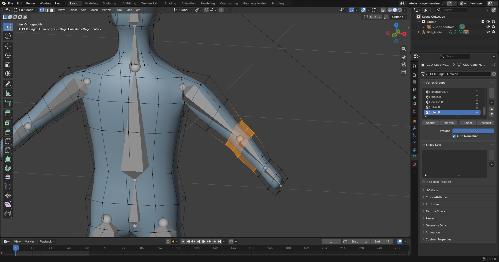

# Leçon 4 — Construire le corps humain

**Temps indicatif** 4–7 h.

## Objectif

Construire par régions une cage polygonale connectée que l’on peut corriger en orthographique.

## Résultat attendu

Une cage de corps habillée ou mannequin, avec épaules, aine, poignets et chevilles lisibles.

Schéma pédagogique. Les libellés décrivent ce qu’il faut lire dans Blender.

[Cage humaine de comparaison éditable](assets/cage_humain.blend)

Le maillage simplifie le visage et les mains. Il sert à suivre les anneaux depuis le bassin et le torse, puis jusqu’aux membres.

## Outils

`Tab` · `1/2/3` · `E` · `G/S/R` · `Ctrl+R` · `M` · `Numpad 1/3`. Raccourcis de la keymap Blender par défaut.

## Erreurs fréquentes

Sélectionnez uniquement les faces de départ. Si vous annulez le déplacement après `E` sans annuler l’extrusion elle-même, des faces peuvent rester superposées.

## Tutoriel dans Blender

### bassin — Bloquer le bassin

Ajoutez un cube au niveau du bassin, dimensionnez-le selon les deux guides puis appliquez l’échelle en Object Mode. Passez en Edit Mode, ajoutez la boucle médiane et gardez un seul côté. Activez Mirror X d’après la [leçon 5](hum-mirror.md). Réservez au moins une face de sortie sous chaque hanche et coupez le côté en quads.

**Vérification** La largeur du bassin tient en face et son inclinaison se lit en profil. Le bord médian est à X=0.

### torse — Extruder taille et cage thoracique

Sélectionnez les faces supérieures, `E Z` jusqu’à la taille, puis réduisez la section en X et ajustez sa profondeur en Y. Extrudez vers le bas de la cage thoracique puis vers la poitrine. Réglez la taille face et profil à chaque anneau.

**Vérification** La taille et la cage ont des sections distinctes. La ligne du dos ne devient pas une droite arbitraire.

### epaule — Former l’épaule depuis le torse

En sélection de faces (`3`), choisissez la face latérale située au haut de la cage. `I` léger si cette face est trop grande, `E` vers l’extérieur pour créer la transition du deltoïde. Ajustez sa largeur et son angle. Prolongez la même région vers le niveau du coude.

**Vérification** L’épaule a une transition avant et arrière. Aucune face ne détache le bras du torse.

### bras — Placer le coude, puis l’avant-bras

L’épaule se prolonge dans le torse. Les sommets orange indiquent la zone où le bras doit pouvoir plier.

Au coude, extrudez un anneau court puis l’avant-bras jusqu’au poignet. Avec `Ctrl+R`, placez une boucle de part et d’autre du coude. En profil, décalez la section du coude et réduisez celle du poignet. Les boucles courtes fixent la zone qui doit fléchir.

**Vérification** En face et profil, l’axe épaule-coude-poignet suit les repères. Les anneaux ne se traversent pas.

### mains — Construire la main et le pouce

Extrudez depuis le poignet une section plus large et plus plate pour la paume. Ajoutez des divisions sur l’extrémité pour obtenir quatre faces de sortie, puis extrudez les doigts un par un. Sur un côté de la paume, ouvrez une face distincte pour un pouce oblique. Pour un premier rig, privilégiez une paume et quatre doigts simples.

**Vérification** Les espaces entre doigts et le départ du pouce se lisent en vue du dessus. Ne soudez pas des sommets de deux doigts voisins.

### jambes — Extruder cuisse, genou et cheville

Sélectionnez la ou les faces inférieures du bassin de la moitié visible, en préservant la couture d’entrejambe sur l’axe. Extrudez la cuisse, réduisez au genou, placez deux anneaux proches et poursuivez jusqu’à la cheville. En profil, réglez le mollet en arrière de l’axe du genou.

**Vérification** L’entrejambe se referme avec Mirror, mais les jambes restent distinctes. En profil, la jambe a un genou et un mollet lisibles.

### pieds — Former la semelle et l’avant-pied

Depuis la cheville, extrudez vers le bas puis vers l’avant (−Y). Réglez la longueur et la largeur du pied en profil et en vue du dessus. Aplatissez uniquement les sommets de la semelle avec `S Z 0`, puis alignez-les au sol.

**Vérification** Les deux semelles sont à Z=0. Le talon et la partie avant se distinguent. Une chaussure doit contenir le pied réel.

### tete — Extruder le cou et fermer la tête

Depuis le haut du torse, extrudez une base de cou, une section plus fine puis le volume de la tête. Si la tête est déjà séparée, joignez les objets, supprimez les faces qui bouchent l’interface et faites Bridge Edge Loops avec des comptages identiques. Voir [la tête et le visage](hum-visage.md).

**Vérification** Inspectez sous la mâchoire et dans la nuque. Le cou et la tête sont connectés. Comparez [ce contrôle en coupe du pied](../../PROPOSITIONS/RECONSTRUCTION_2_VUES/pied_chaussure_coupe.png).

### controle — Vérifier et refaire une région

Enregistrez le fichier avant de subdiviser. Passez devant, profil et trois-quarts, comparez les proportions et refaites un avant-bras sur une copie en évitant de lire les étapes.

**Vérification** Remettez votre .blend avec cage editable et trois vues. Notez une erreur détectée en profil et sa correction.

