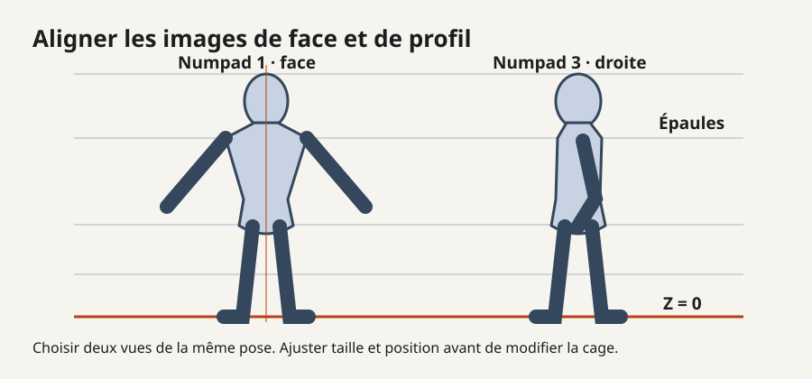
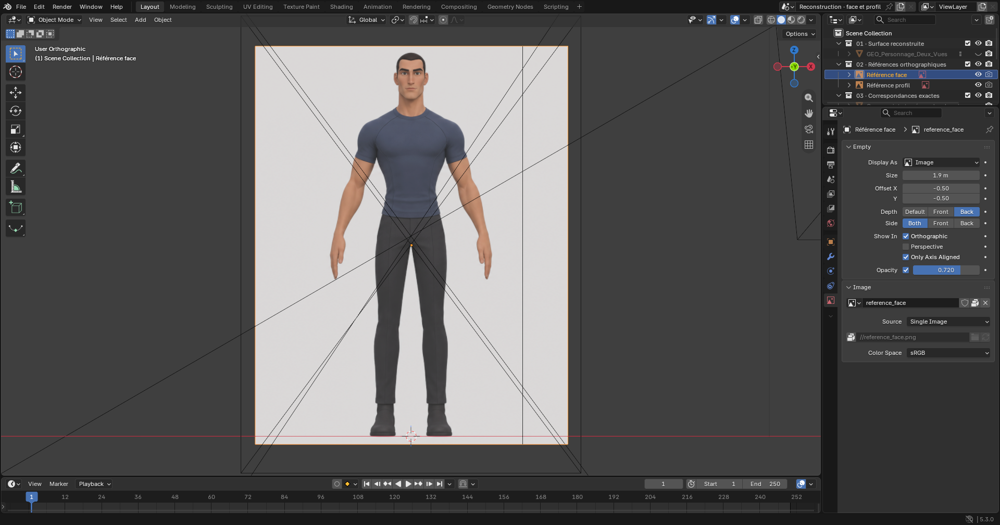
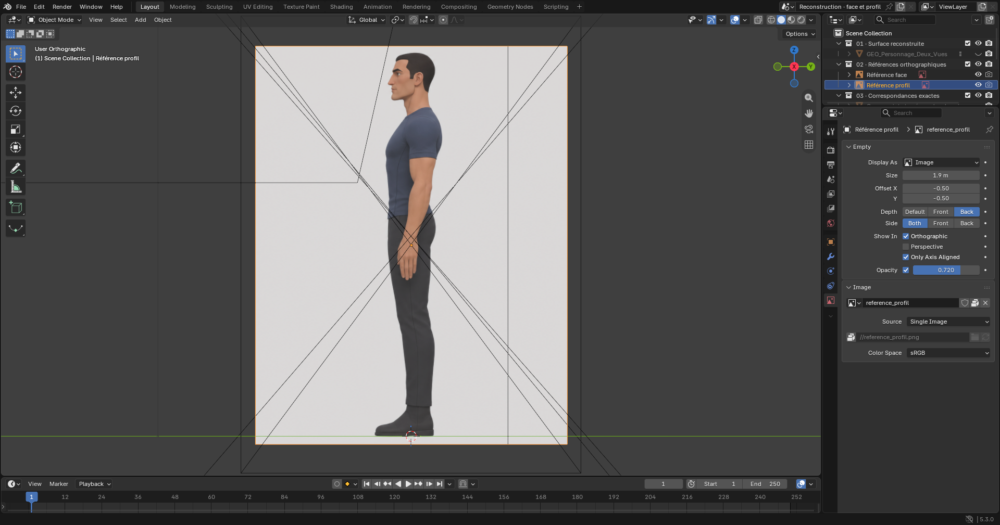

# Leçon 3 — Importer et aligner les photos dans Blender

**Temps indicatif** 45–60 min.

## Objectif

Obtenir deux gabarits orthographiques utilisables en modélisation.

## Résultat attendu

Un fichier Blender avec deux images visibles seulement dans les vues utiles, et des repères au sol et au crâne.

Schéma pédagogique. Les libellés décrivent ce qu’il faut lire dans Blender.

## Outils

`Numpad 1` · `Numpad 3` · `Numpad 5` · `Shift+A` · `G` · `S` · `N`. Raccourcis de la keymap Blender par défaut.

## Erreurs fréquentes

Importer en perspective peut orienter l’Empty selon la vue courante. Recommencez depuis l’ortho au lieu de compenser à l’œil.

## Tutoriel dans Blender

### face — Ouvrir et importer la face

Le panneau de données de l’image affiche ses réglages. Repérez l’axe central et le sol.

Ouvrez Blender en Object Mode. Supprimez le cube si vous partez d’un fichier vide. `Numpad 1` affiche Front Orthographic. `Shift+A` → Image → Reference… et choisissez [le gabarit de face](../../PROPOSITIONS/RECONSTRUCTION_2_VUES/reference_face.png) ou votre photo. Renommez l’objet REF_Face.

**Vérification** La face est lisible sans foreshortening. Si vous n’avez pas de pavé, utilisez View → Viewpoint → Front.

### axe — Définir hauteur et axe de symétrie

Activez l’unité métrique et utilisez un segment-guide vertical de la taille cible entre Z=0 et le sommet. Mettez l’image à l’échelle par `S`, puis placez les semelles à Z=0 avec `G Z` et le milieu du corps à X=0. Déplacez l’image légèrement derrière le volume sur Y si besoin.

**Vérification** En vue de face, les semelles touchent Z=0 et l’axe médian passe par menton et bassin.

### profil — Importer le profil

Sur l’image de profil, retrouvez le sol et le sommet du crâne avant d’ajuster les autres repères.

Passez à Right Orthographic avec `Numpad 3`. Importez [le profil](../../PROPOSITIONS/RECONSTRUCTION_2_VUES/reference_profil.png) par `Shift+A` → Image → Reference…. Ajustez `S` et `G Z`. Déplacez sur Y pour aligner le corps du profil avec l’axe de travail. Choisissez une convention stable, par exemple le visage vers −Y.

**Vérification** Les deux semelles, le crâne et au moins trois repères intermédiaires coïncident. Si nécessaire retournez le gabarit dans son plan, puis confirmez le sens du visage.

### affichage — Régler l’affichage et enregistrer

Sélectionnez chaque Empty Image et consultez Object Data Properties. Réglez Opacity autour de 0,35 à 0,6, Depth sur Back et l’affichage Only Axis Aligned si disponible. Rangez les images dans REF. Testez deux vues puis désactivez la sélection de la collection via l’Outliner si nécessaire.

**Vérification** Les images ne masquent pas le mesh en perspective. Sauvegardez puis rouvrez. [Exemple Blender avec images intégrées](../../PROPOSITIONS/RECONSTRUCTION_2_VUES/personnage_deux_vues.blend).

