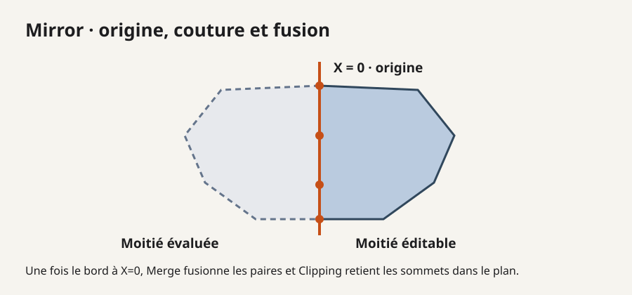
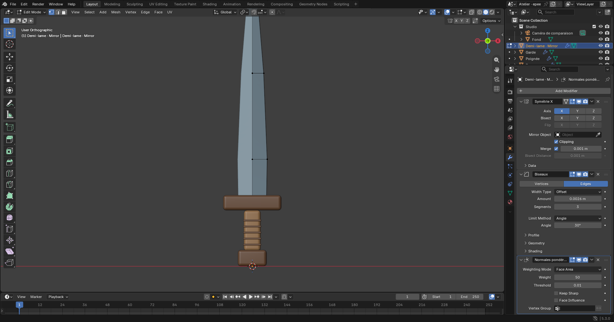

# Leçon 5 — Mirror et couture centrale

**Temps indicatif** 45–75 min.

## Objectif

Modéliser une moitié avec un centre stable et une couture fusionnée.

## Résultat attendu

Une demi-cage modifiable sur X, avec couture à X=0 et silhouette symétrique.

Schéma pédagogique. Les libellés décrivent ce qu’il faut lire dans Blender.

## Outils

`Tab` · `S X 0` · `N` · `Mirror` · `Clipping` · `Merge`. Raccourcis de la keymap Blender par défaut.

## Erreurs fréquentes

Clipping empêche de franchir le plan lorsqu’un sommet est pris dans la zone. Une couture déjà trop loin ne se corrige pas en activant uniquement Clipping.

## Tutoriel dans Blender

### origine — Faire coïncider origine et plan de miroir

Placez le curseur au centre si l’axe du modèle est à X=0. En Object Mode, Set Origin → Origin to 3D Cursor, puis `Ctrl+A` → Rotation & Scale si nécessaire avant Mirror.

**Vérification** Le plan du modificateur correspond à l’axe du personnage. Il dépend de l’origine et des axes locaux.

### demi — Nettoyer la demi-cage

En Edit Mode, supprimez un côté et les faces superposées sur la couture. Sélectionnez le bord central, pressez `S X 0`, puis réglez sa position X à 0 dans le panneau Item.

**Vérification** Le bord est plat et tous les sommets du centre sont sur le même plan.

### options — Éprouver Merge et Clipping

Cette pièce d’exercice isole les réglages de l’axe X, de Merge et de Clipping. Retrouvez ces mêmes réglages sur le corps.

Ajoutez Mirror avant Subdivision Surface. Activez X, Merge et Clipping, gardez une faible distance de fusion. Éloignez temporairement un sommet au-delà de la distance sur une copie, puis replacez-le.

**Vérification** Le seam disparaît à la bonne position. Alt+clic sur un bord aide à vérifier la continuité de la cage.

### preuve — Transformer sans perdre la couture

Modifiez la largeur d’une épaule et une section de taille. Sauvegardez une copie non appliquée pour garder les réglages.

**Vérification** La silhouette change des deux côtés et la couture reste fermée.

