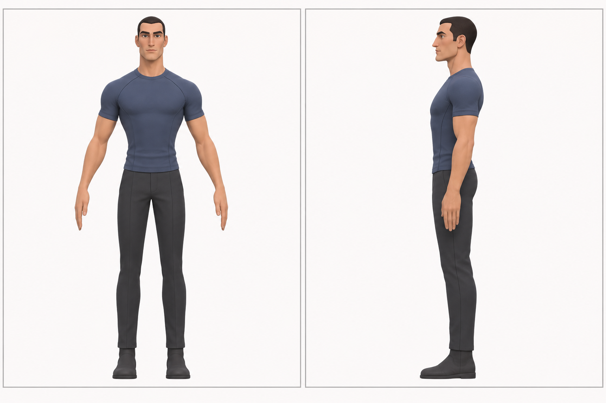

# Leçon 2 — Préparer les photos

**Temps indicatif** 45–75 min.

## Objectif

Choisir et calibrer des photos qui peuvent servir de gabarits.

## Résultat attendu

Deux images cohérentes, une échelle en mètres et cinq lignes de repère à reporter.

Gabarit synthétique du cours. Utilisez la procédure pour préparer de vraies photographies autorisées.

## Outils

`Numpad 1` · `Numpad 3`. Raccourcis de la keymap Blender par défaut.

## Erreurs fréquentes

Une photo proche prise au grand-angle peut agrandir le nez ou les pieds. Un étirement indépendant de l’image corrige rarement la perspective.

## Tutoriel dans Blender

### prise — Choisir ou prendre les photos

Utilisez vos photos ou des images utilisées avec permission. Photographiez le même sujet de face et strictement de profil, corps entier, pieds visibles, dos droit et éclairage diffus. Éloignez la caméra pour réduire la perspective et gardez la même hauteur, le même cadrage et la même pose entre les vues.

**Vérification** Le visage n’est ni incliné ni tourné. En profil, un œil domine et l’autre côté ne forme pas un fort trois-quarts.

### calibrer — Comparer les repères avant d’importer

Repérez sol et sommet du crâne sur les deux photos. Calculez la hauteur en pixels du sujet sur chacune, puis choisissez une taille de travail. Pour une hauteur de 1,75 m et 875 px, 500 px représentent un mètre. Ajustez par mise à l’échelle uniforme si les deux photos n’ont pas le même cadre.

**Vérification** Le sommet et les semelles coïncident après recalage. Marquez yeux, épaules, hanches, genoux et malléoles.

### decider — Gérer ce que les photos ne montrent pas

Masquez les accessoires qui obscurcissent les repères si vous pouvez refaire la prise. Si le bras couvre le flanc, estimez la profondeur du torse depuis une troisième vue autorisée ou une approximation indiquée. Identifiez trois différences entre les hauteurs relevées.

**Vérification** Écartez une paire qui change clairement de pose. La planche incluse est une illustration générée pour l’exercice, pas une photographie réelle.

### preuve — Préparer les fichiers de travail

Créez un dossier References, nommez les images face et profil, conservez les originaux et notez la taille cible. Annotez des copies ou notez les coordonnées des repères.

**Vérification** Les noms, sources, orientation, échelle et écarts éventuels sont écrits.

