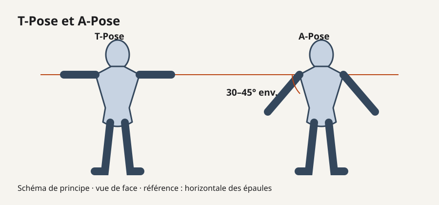

# Leçon 1 — T-Pose et A-Pose

**Temps indicatif** 30–45 min.

## Objectif

Choisir une pose de référence et comprendre son effet sur l’épaule, la silhouette et le rig.

## Résultat attendu

Deux croquis annotés et une pose de travail choisie.

Schéma pédagogique. Les libellés décrivent ce qu’il faut lire dans Blender.

## Outils

`Numpad 1` · `Numpad 3`. Raccourcis de la keymap Blender par défaut.

## Erreurs fréquentes

Une A-Pose n’est pas une pose courbée ou asymétrique. Pour les références, gardez les deux pieds au sol, les mains détendues et le regard droit.

## Tutoriel dans Blender

### t — Lire la T-Pose

Tracez une ligne horizontale aux épaules et placez les bras près de cette ligne, doigts relâchés. Cette disposition sépare les bras du torse et expose l’aisselle, mais rapproche le bras d’une posture extrême.

**Vérification** Les avant-bras prolongent le bras et le bassin reste au-dessus des appuis.

### a — Comparer l’A-Pose

Sur une copie, abaissez les bras d’environ 30° à 45° par rapport à l’horizontale. Comparez la forme du deltoïde et la profondeur de l’aisselle. L’A-Pose est pratique pour un personnage dont les bras redescendent souvent.

**Vérification** Les bras sont suffisamment écartés pour distinguer bras et buste en face. Le schéma indique une plage, pas un angle universel.

### choix — Choisir et cadrer une pose

Prenez la pose que permettent vos deux photos et le rig que vous voulez utiliser. Pour un premier essai, une A-Pose modérée offre un bon compromis. Gardez cette pose sur la face et le profil.

**Vérification** Dans le carnet, notez la pose, l’orientation du visage et une raison de ce choix.

