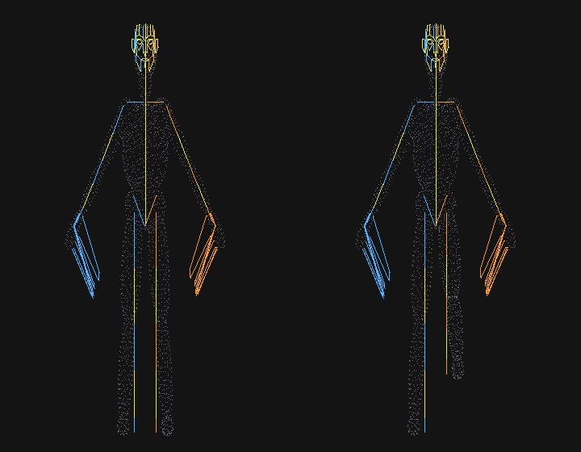
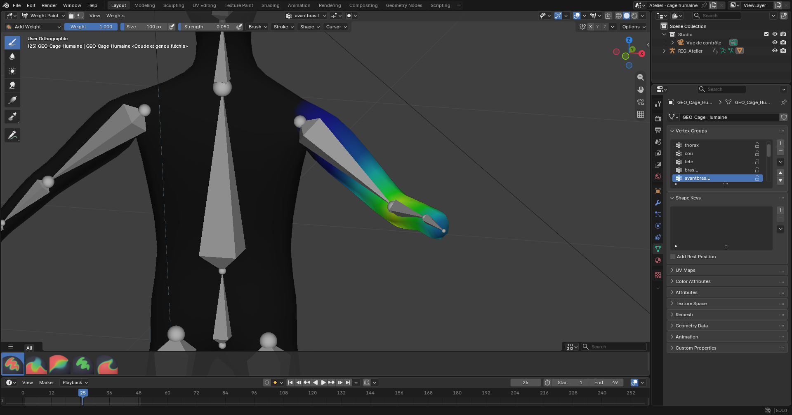

# Leçon 8 — Préparer le personnage à l’animation

**Temps indicatif** 2–4 h.

## Objectif

Construire et vérifier une armature simple et corriger quelques poids.

## Résultat attendu

Le corps parenté à une armature, deux poses et un retour à la pose neutre.

Rendu Blender de comparaison, présenté comme exemple et non comme capture du pas-à-pas.

[Scène d’initiation avec armature et pose à l’image 25](assets/cage_humain.blend)

## Outils

`Shift+A` · `Tab` · `E` · `Ctrl+P` · `Pose Mode` · `Alt+R`. Raccourcis de la keymap Blender par défaut.

## Erreurs fréquentes

Appliquez la rotation et l’échelle avant le parentage. Un parentage réussi ne prouve pas que toutes les zones ont reçu des poids corrects.

## Tutoriel dans Blender

### preparer — Préparer le corps et le squelette

Dupliquez le personnage versionné, appliquez Mirror sur la copie de rig si nécessaire et vérifiez Rotation & Scale. Ajoutez Armature → Single Bone. Dans Object Data de l’armature, activez In Front pour voir les os.

**Vérification** Le maillage de rig est un seul corps fermé et à l’échelle. Conservez séparément la cage éditable avec Mirror.

### os — Placer des os simples

En Edit Mode de l’armature, placez bassin et colonne, puis extrudez vers cou et tête. Construisez bras avant-bras puis cuisse tibia pied. Placez les pivots au centre optique des articulations dans les deux vues. Nommez les côtés .L et .R et utilisez Symmetrize avec une convention cohérente.

**Vérification** Les extrémités coïncident aux articulations. Le bassin commande les chaînes prévues. Les noms s’affichent correctement.

### parent — Lier le mesh et examiner les groupes

En Object Mode, sélectionnez le corps, puis l’armature en dernier. `Ctrl+P` → Armature Deform → With Automatic Weights. Vérifiez le modificateur Armature et les vertex groups. Si Bone Heat échoue, contrôlez géométrie et transformations, puis utilisez des poids par régions pour la zone d’essai.

**Vérification** Le bras change de forme avec son os en Pose Mode. Des sommets proches du coude partagent les deux groupes adjacents.

### pose — Prouver la déformation

Le groupe avantbras.L affiche la transition des poids dans la zone du coude. Utilisez les images 1 et 25 du fichier atelier pour comparer.

En Pose Mode, pliez un coude puis un genou. En Weight Paint, corrigez la transition autour du pli avec Normalize All ou les groupes pondérés en gardant des poids normalisés. Utilisez `Alt+R` en Pose pour réinitialiser les rotations du test.

**Vérification** Enregistrez deux poses et vérifiez le retour à la pose neutre. [Voir un exemple de marche plus avancé](../../PROPOSITIONS/RECONSTRUCTION_2_VUES/marche_personnage_0001-0096.mp4).

