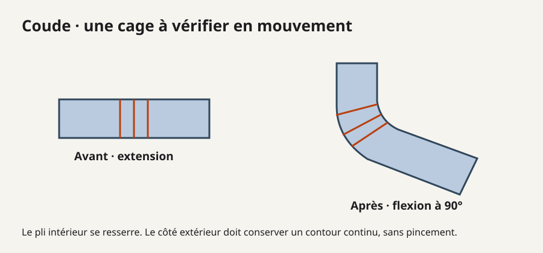
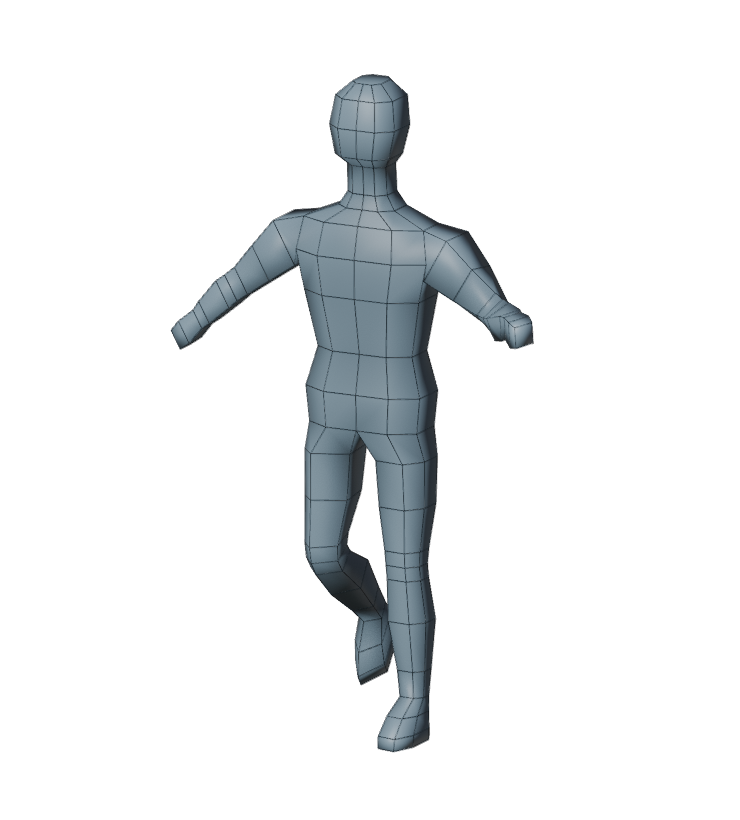

# Leçon 7 — Retopologie, anatomie et déformations

**Temps indicatif** 2–4 h.

## Objectif

Placer les boucles utiles autour des articulations et apprendre à diagnostiquer une déformation.

## Résultat attendu

Un coude en quads testé à 90°, une correction et un échantillon de topologie du visage.

Schéma pédagogique. Les libellés décrivent ce qu’il faut lire dans Blender.

Dans la [scène éditable](assets/cage_humain.blend), comparez les images 1 et 25. Les traits sont les véritables arêtes de la cage.

## Outils

`Ctrl+R` · `M` · `Alt+clic` · `Shift+N` · `Poly Build` · `Shrinkwrap`. Raccourcis de la keymap Blender par défaut.

## Erreurs fréquentes

Une grille uniforme ou un maillage tout en quads ne suffit pas. Les pôles et les changements abrupts de densité se remarquent dans les plis.

## Tutoriel dans Blender

### lecture — Lire quads, boucles et pôles

Affichez la cage. Suivez les boucles avec Alt+clic là où la topologie le permet. Marquez les sommets à 3 ou 5 arêtes et observez où les boucles s’arrêtent. Localisez les patches plus denses dans les yeux et la bouche.

**Vérification** Le flux indique quels volumes peuvent changer indépendamment. Comparez [la référence de retopologie](../../03_SCULPTING/CH03_09_RETOPOLOGY/COMPLETED_EXAMPLES/ch03_09_retopo_reference.png).

### coude — Installer les anneaux de flexion

Placez au moins une boucle principale à l’axe du coude et deux boucles voisines, en ajustant l’espacement. Gardez une densité plus basse sur les segments droits. Faites de même au genou.

**Vérification** Le raccord des anneaux suit le pli et l’extérieur conserve du volume.

### retopo — Corriger une zone mal connectée

Isolez une petite région du modèle. Sur un objet de retopologie séparé, créez un patch avec Poly Build et Snap to Face, ou projetez-le avec Shrinkwrap. Lorsque les quads tiennent la forme, raccordez un contour compatible ou gardez un patch d’essai distinct.

**Vérification** Préférez un patch petit et contrôlable. Évitez les doublons et vérifiez les normales.

### deformer — Tester puis corriger

Utilisez le [rig minimal](hum-rig.md) pour plier le coude à 90°. Comparez la cage avant/après, corrigez la position d’une boucle ou le poids autour du pli, puis répétez.

**Vérification** Livrez le coude en extension, à mi-flexion et à 90°. Une zone rigide ou pincée doit être identifiée et corrigée.

