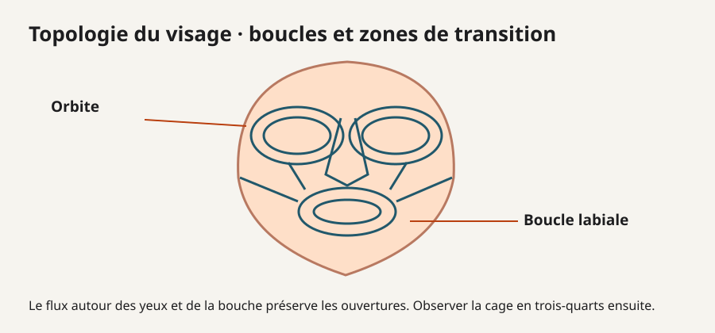
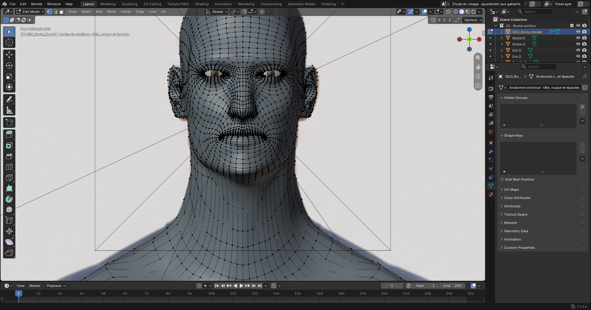

# Leçon 6 — Modéliser la tête et le visage

**Temps indicatif** 3–6 h.

## Objectif

Construire des volumes et des boucles faciles à retoucher plutôt que coller des détails sur une sphère.

## Résultat attendu

Une tête raccordée ou raccordable, avec cage faciale inspectable et globe séparé.

Schéma pédagogique. Les libellés décrivent ce qu’il faut lire dans Blender.

[Buste anatomique éditable pour comparer les volumes](../../PROPOSITIONS/RECONSTRUCTION_2_VUES/visage_recale.blend)

## Outils

`Numpad 1/3` · `Mirror` · `E` · `I` · `G` · `Ctrl+R` · `Bridge Edge Loops`. Raccourcis de la keymap Blender par défaut.

## Erreurs fréquentes

Une bouche qui semble correcte de face peut dépasser en profil. Une paupière se lit par son contact avec le globe, pas par son épaisseur seule.

## Tutoriel dans Blender

### crane — Construire le crâne et la mâchoire

Depuis l’anneau du cou, modélisez les sections du menton, de la mâchoire, des pommettes et de la boîte crânienne. Définissez le profil avant les détails. Fermez le haut avec des quads continus autant que possible.

**Vérification** Le front, le menton et l’occiput existent en vue de profil. Voir [la référence faciale en argile](../../PROPOSITIONS/RECONSTRUCTION_2_VUES/visage_recale_profil.png).

### orbites — Créer les orbites et poser les globes

Sur l’exemple avancé, repérez le flux autour de l’orbite, puis suivez les arêtes jusqu’à la joue et à la bouche.

Repérez le niveau des yeux. Créez une boucle autour d’une zone orbitale par Inset d’un patch puis ajustez les sommets autour du globe. Placez un globe distinct en retrait et extrudez les bords de paupière jusqu’à son contact apparent.

**Vérification** Le globe ne flotte pas et la paupière supérieure reste plus lisible que le bord inférieur. Inspectez en trois-quarts.

### nez — Construire le nez à partir de la face

Sélectionnez un patch central de la cage sous l’arcade, extrudez la base du nez et placez la pointe depuis le profil. Contrôlez la saillie en vue de dessous, puis ajoutez un peu de largeur aux ailes.

**Vérification** Le nez est dans la même surface que le visage. Évitez de créer le détail des narines avant de valider la silhouette.

### bouche — Créer une boucle de bouche

Dessinez un anneau autour de la zone labiale avec des quads. Ajustez les commissures et les hauteurs des lèvres, puis rentrez légèrement la rangée de séparation. Gardez une bouche fermée simple pour ce premier modèle.

**Vérification** Les lignes rayonnent autour de l’ouverture et évitent un pôle directement sur une commissure.

### oreille — Intégrer les oreilles dans le profil

Repérez la hauteur entre sourcils et base du nez avec la photo. Depuis un patch latéral, extrudez un volume mince, placez-le en arrière et façonnez une conque simple par Inset et une faible extrusion intérieure. Gardez l’oreille simple tant que la tête n’est pas lisible.

**Vérification** Comparez gauche et profil. Le raccord du pavillon est visible et cohérent.

### preuve — Comparer le détail sous trois angles

Rendez une vue en argile et comparez à une copie où vous changez une mâchoire ou une pommette sans décaler le globe. Enregistrez aussi une vue cage.

**Vérification** Identifiez précisément une amélioration du profil et une du trois-quarts.

