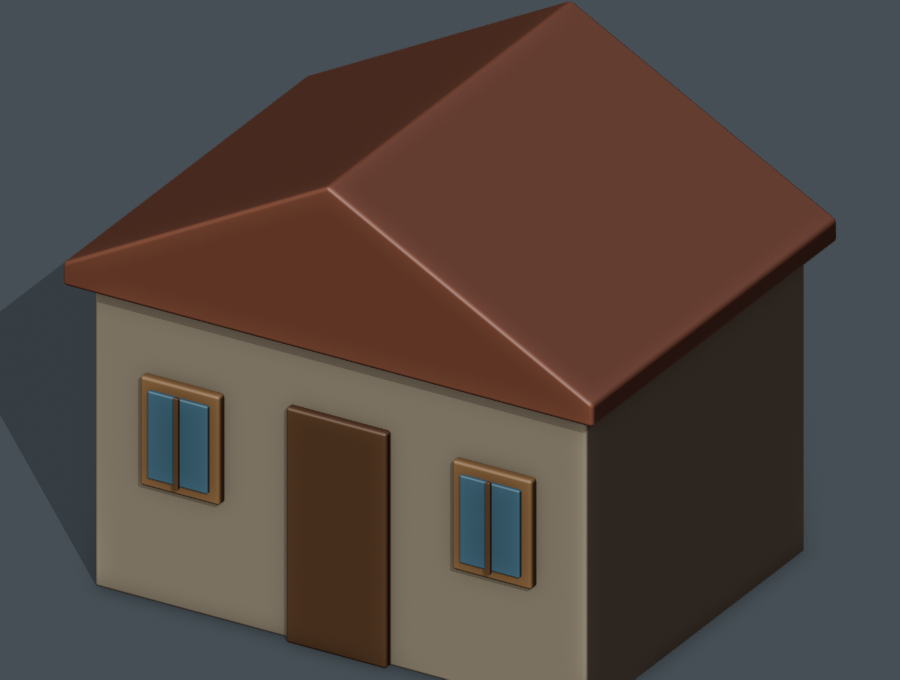

# 6. Petite maison

**Temps indicatif** 3–4 h.

## Objectif

Assembler murs, volumes de toiture et ouvertures à partir d’un gabarit.

## Résultat attendu

Une maison de 4 × 3 m, lisible de face et de trois-quarts, avec toit en pente, porte et deux fenêtres.

Ce visuel est un rendu de comparaison réalisé dans Blender. Le résultat se contrôle également en vue Solid et en filaire.

[Scène Blender de comparaison](assets/maison.blend)

## Outils

`Tab` · `Ctrl+R` · `G` · `E` · `I` · `K` · `Ctrl+B`. Raccourcis de la keymap Blender par défaut.

## Erreurs fréquentes

La faîtière doit être centrée et le débord du toit doit tomber au-delà du mur. Contrôlez les ouvertures en ortho.

## Tutoriel dans Blender

### murs — Fixer le gabarit

Dimensionnez un cube 4 × 3 × 2,45 m, puis placez-le à Z=1,225 m. Appliquez l’échelle. Tracez le sol de référence séparément.

**Vérification** Le bas est à Z=0 et le haut des murs à Z=2,45 m.

### toit — Former les deux versants

Ajoutez un cube au-dessus des murs, légèrement plus large. En Edit Mode, créez une boucle médiane sur le dessus dans le sens de la faîtière, puis sélectionnez son arête du haut et faites `G Z` pour la monter. Gardez les arêtes inférieures des versants au même niveau.

**Vérification** Les deux pans se lisent en profil et débordent de façon régulière.

### facade — Découper et hiérarchiser la façade

Ajoutez deux coupes horizontales et deux verticales sur une façade en quads pour encadrer les ouvertures. Pour une fenêtre, sélectionnez la face du panneau, faites `I` pour créer un encadrement et extrudez vers l’intérieur. Si un tracé manque, utilisez `K` de bord à bord puis `Entrée`.

**Vérification** Le cadre est plus large que la partie en retrait. L’exercice crée des embrasures, qui peuvent rester fermées pour une maquette extérieure.

### preuve — Vérifier la circulation et modifier une façade

Ajoutez le sol et une porte distincte. Sauvegardez une variante où la porte change de côté. Contrôlez le toit, la hauteur d’ouverture et les échelles.

**Vérification** Quatre vues orthographiques plus un trois-quarts. Les changements ne modifient pas le gabarit des murs.

