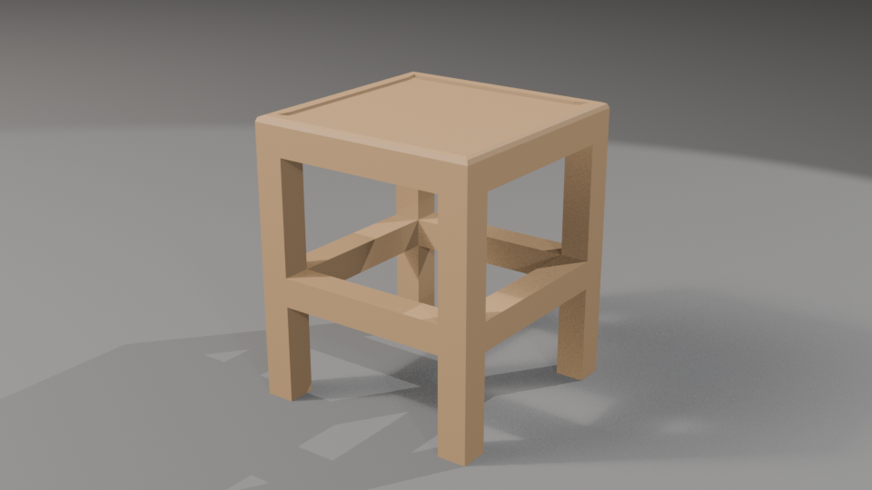
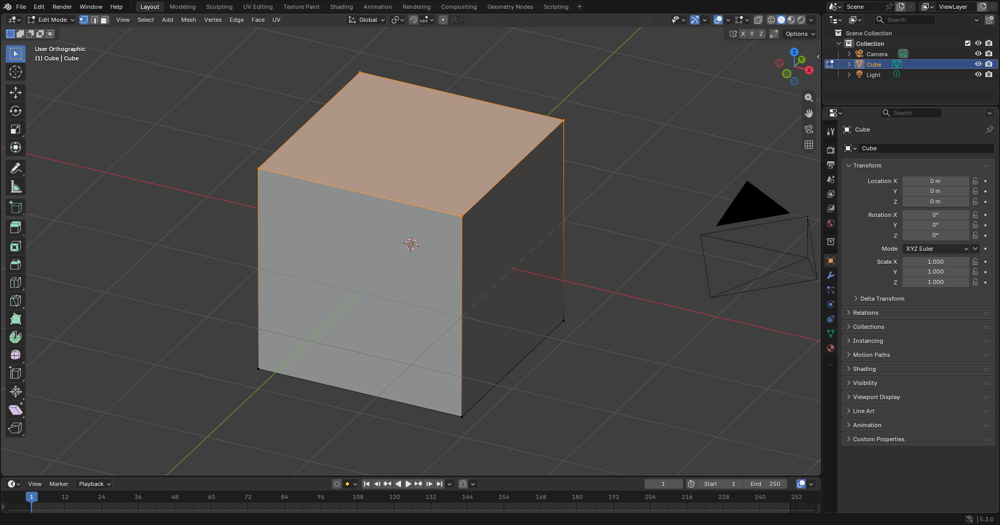

# Les outils de modélisation sur une pièce d’essai

**Temps indicatif** 45–60 min.

## Objectif

Transformer, couper et nettoyer une pièce en choisissant le bon mode et le bon type de sélection.

## Résultat attendu

Une pièce avec rebord, biseau et coupe visible, plus une variante à partir d’un cube vierge.

Ce visuel est un rendu de comparaison réalisé dans Blender. Le résultat se contrôle également en vue Solid et en filaire.

## Outils

`Tab` · `1` · `2` · `3` · `G/R/S` · `E` · `I` · `Ctrl+B` · `Ctrl+R` · `M` · `O` · `K` · `Shift+N`. Raccourcis de la keymap Blender par défaut.

## Erreurs fréquentes

Repère : `1`, `2`, `3` au-dessus des lettres changent le type de sélection en Edit Mode. Le pavé numérique change la vue.

## Tutoriel dans Blender

### modes — Distinguer objet et maillage

Le bandeau affiche les trois modes de sélection. Comparez avec le [même cube en mode Objet](assets/captures/01-modes-objet.png).

Ajoutez un cube. En Object Mode, `G X 2`, `R Z 15`, `S .8`. Annulez ces trois gestes. Avec `Tab`, entrez en Edit Mode. Sélectionnez seulement les sommets supérieurs (`1`, `Alt+Z` si nécessaire), puis faites `G Z .2`. La géométrie change sans déplacement de l’origine.

**Vérification** Revenez en Object Mode. Vérifiez que le point d’origine est resté au milieu et que seule la partie supérieure a bougé.

### faces — Créer un rebord et un creux

En Edit Mode, `3`, sélectionnez la face supérieure. `I` crée le rebord. `E` puis saisissez une faible distance négative pour creuser la face intérieure. Le pourtour et le fond restent connectés.

**Vérification** En trois-quarts, distinguez le bord horizontal, les parois et le fond.

### aretes — Biseauter et couper

Passez en sélection d’arêtes avec `2`. Sélectionnez une arête extérieure et faites `Ctrl+B`, réglez la largeur et les segments. Sur un flanc en quads, survolez une arête, lancez `Ctrl+R`, cliquez puis clic droit pour centrer la boucle. Cette boucle distribue la géométrie où elle sera utile.

**Vérification** Le biseau capte un reflet et la boucle parcourt le flanc. Si un n-gon arrête la boucle, essayez sur un cube séparé en quads.

### coupe — Découper et fusionner un essai séparé

Sur un deuxième cube, activez `K` et tracez entre deux arêtes d’une face, puis `Entrée`. Faites ensuite `F3` → Subdivide sur une face de test. Sélectionnez deux sommets voisins et choisissez `M` → At Center. Recommencez sur une copie pour observer la différence avec Merge by Distance, qui fusionne les sommets seulement s’ils sont assez proches.

**Vérification** Passez en `1` et vérifiez les sommets. Subdivide densifie, Knife suit votre tracé et Merge réduit le nombre de sommets.

### forme — Déformer et contrôler l’ombrage

Sur la version subdivisée, sélectionnez un sommet, activez `O`, faites `G Z` et réglez le rayon à la molette. Désactivez `O`, puis `A` et `Shift+N`. En Object Mode, comparez Shade Smooth et Shade Auto Smooth ou Shade Smooth by Angle selon le menu installé via `F3`.

**Vérification** Les sommets voisins suivent pendant l’édition proportionnelle. L’ombrage peut changer sans modifier la silhouette.

### miroir — Essayer Mirror puis Subdivision Surface

Sur un cube centré, faites une boucle médiane perpendiculaire à X et supprimez les sommets de gauche. Ajoutez Mirror par Properties → Modifiers, axe X, Merge et Clipping. Ajoutez Subdivision Surface après Mirror. Déplacez une arête loin du centre et rapprochez une boucle de soutien du bord.

**Vérification** Les deux côtés suivent. La boucle rapprochée garde le bord plus net. Si la jonction s’ouvre, vérifiez les sommets X=0 et l’origine avant de toucher à la distance de fusion.

### preuve — Refaire le geste sur un autre volume

Sans lire les valeurs précédentes, faites un creux décentré sur une nouvelle pièce, coupez un flanc au Knife et changez le rayon du biseau. Sauvegardez les deux variantes dans le même fichier.

**Vérification** Montrez la cage, la surface ombrée et la commande utilisée pour chaque différence.

