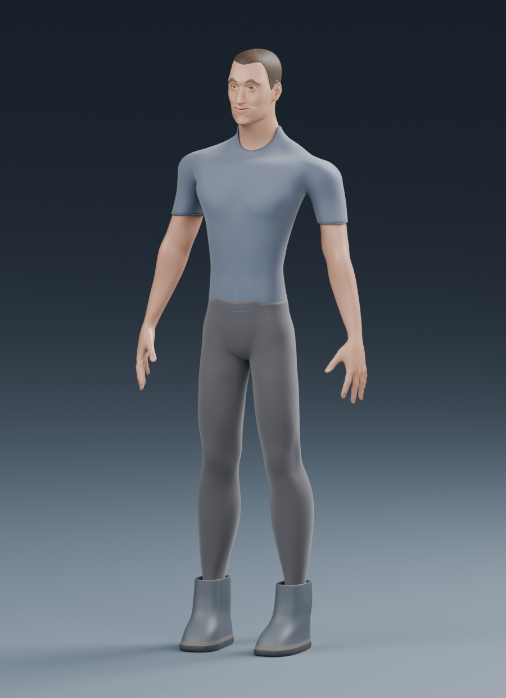
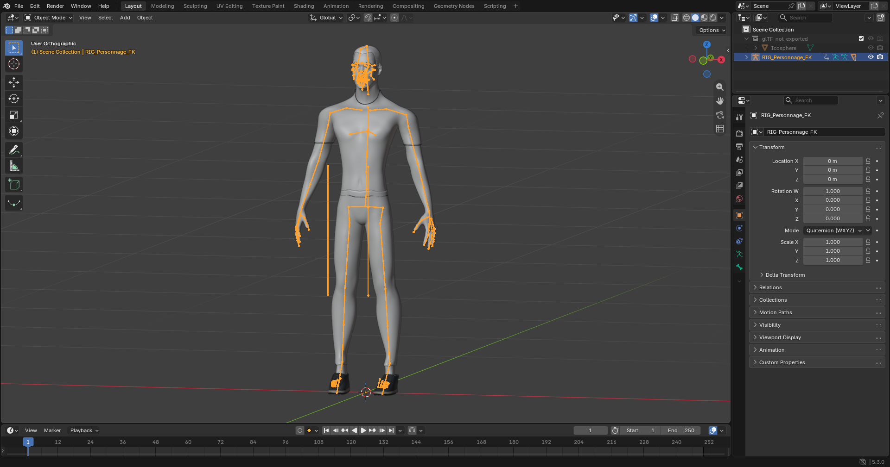

# Projet final — Modéliser un personnage humain complet dans Blender à partir de photographies en A-Pose ou T-Pose

**Temps indicatif** 10–18 h en plusieurs séances.

## Objectif

Assembler les acquis dans un personnage éditable testé et exporté.

## Résultat attendu

Un .blend avec références, cage, matériaux et armature, plus un export FBX ou glTF réimporté et deux preuves de pose.

Rendu Blender de comparaison, présenté comme exemple et non comme capture du pas-à-pas.

## Exemple de livraison vérifié

Le personnage avancé utilise la base MakeHuman (CC0) et les deux gabarits synthétiques fournis. Pour valider votre projet, travaillez avec vos propres photographies autorisées et conservez vos versions intermédiaires.

- [Fichier Blender source avec références et textures intégrées](assets/projet_humain/personnage_source.blend)
- [Personnage animé en GLB](assets/projet_humain/personnage.glb) et [scène de contrôle réimportée](assets/projet_humain/verification_import.blend)
- [Face](assets/projet_humain/face.png), [profil](assets/projet_humain/profil.png), [trois-quarts](assets/projet_humain/trois_quarts.png), [pose 1](assets/projet_humain/pose_01.png) et [pose 2](assets/projet_humain/pose_02.png)
- [Mesures du réimport Blender](assets/projet_humain/verification.json)

Le GLB contient le squelette, son animation et la texture de peau. Le fichier Blender source fournit les contrôleurs, les clés de forme et les finitions procédurales.

## Outils

`Mirror` · `Shift+N` · `Ctrl+A` · `Ctrl+P` · `UV Editing` · `Pose Mode`. Raccourcis de la keymap Blender par défaut.

## Erreurs fréquentes

La projection couleur peut masquer des erreurs de silhouette. Validez d’abord le modèle sous un matériau neutre. Le fichier de référence avancé ne remplace pas les étapes.

## Tutoriel dans Blender

### references — 1 · Préparer et documenter les références

Choisissez une A-Pose ou T-Pose et deux photos prises avec autorisation. Documentez source, taille et incohérences.

**Vérification** Même pose. Taille cible notée. Cinq repères comparables.

### alignement — 2 · Importer et aligner

Importez les deux photos en ortho. Placez sol et axe de symétrie, organisez les Empties dans REF et vérifiez leur visibilité.

**Vérification** Sol, crâne et au moins trois repères coïncident. Les références sont livrées ou intégrées.

### volumes — 3 · Bloquer les grands volumes

Fixez bassin, thorax et tête avant les détails. Comparez notamment les épaisseurs de profil.

**Vérification** Face, profil et trois-quarts validés en vue Solid. Gardez une version du blocage.

### corps — 4 · Modéliser corps, mains et pieds

Extrudez bras et jambes depuis les masses principales. Construisez des mains lisibles et un pied continu à la cheville. Placez un appui au sol.

**Vérification** Doigts séparés si le design le permet, semelles au sol, épaules et aines sans raccords visibles.

### tete — 5 · Modéliser la tête

Construisez crâne, mâchoire, globe et orbite, nez, bouche et oreilles. Raccordez le cou dans la cage.

**Vérification** Deux vues en argile. Les yeux sont dans les orbites et le cou fait partie de la surface.

### symetrie — 6 · Contrôler la symétrie

Ajustez l’origine, Mirror, Clipping et Merge. Gardez une version modifiable puis appliquez sur une copie si le rig le demande.

**Vérification** Pas de couture visible. Les changements hors de l’axe se répliquent.

### topologie — 7 · Nettoyer et éprouver la cage

Inspectez les coutures, l’orientation des faces et les flux aux articulations. Remplacez un mauvais patch si nécessaire.

**Vérification** Le corps principal n’a pas de trous involontaires. Les quads et transitions des zones déformables sont lisibles.

### materiaux — 8 · Préparer UV et matériaux

Créez des seams puis dépliez avec `U` → Unwrap. Testez un checker. Ajoutez des matériaux de peau et textile, et empaquetez les images nécessaires via File → External Data → Pack Resources.

**Vérification** Le checker reste régulier et le fichier rouvert retrouve ses matériaux.

### rig — 9 · Ajouter et tester l’armature

Ajoutez le rig minimal, nommez ses os et testez les poids en flexion. Gardez une pose neutre et deux exercices de flexion.

**Vérification** Coude et genou conservent assez de volume, et le retour à la pose neutre fonctionne.

### export — 10 · Exporter et vérifier

Dans la scène réimportée, passez de l’image 1 aux images 25 et 49 pour contrôler les déformations.

Sélectionnez corps, vêtements, yeux et armature. Exportez en FBX ou glTF selon l’usage, puis réimportez dans un nouveau fichier. Vérifiez orientation, échelle, textures et une déformation si elle est incluse. Conservez le .blend complet et les captures de preuve.

**Vérification** Livrer le .blend, l’export vérifié, les trois vues de forme et les deux poses. Si un média externe manque, corrigez le paquet avant validation. [Exemple avancé éditable](../../PROPOSITIONS/RECONSTRUCTION_2_VUES/personnage_final_pieds_ajustes.blend).

