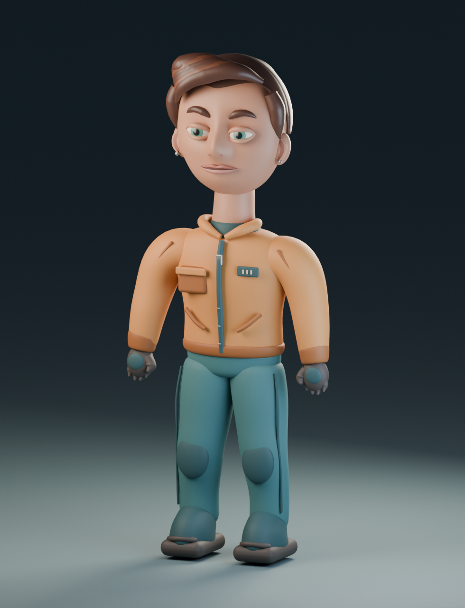

# 7. Personnage stylisé

**Temps indicatif** 3–5 h.

## Objectif

Créer une silhouette identifiable puis donner du caractère avec quelques grands volumes.

## Résultat attendu

Un petit explorateur habillé, tête, torse, bras et jambes lisibles, avec une pose simple.

Ce visuel est un rendu de comparaison réalisé dans Blender. Le résultat se contrôle également en vue Solid et en filaire.

[Personnage stylisé éditable pour la revue de silhouette](../../PROPOSITIONS/MODELISATION/nora_personnage_continu.blend)

## Outils

`Mirror` · `Tab` · `E` · `G/R/S` · `O` · `Subdivision Surface`. Raccourcis de la keymap Blender par défaut.

## Erreurs fréquentes

Si la silhouette ne dit rien en miniature, changez les masses et les angles de pose avant les accessoires.

## Tutoriel dans Blender

### silhouette — Choisir la silhouette avant les détails

Sur papier puis en vue de face, dessinez deux formes très différentes. Choisissez une tête large, un torse en trapèze et une silhouette de bottines. Placez des repères de hauteur.

**Vérification** Les deux esquisses se distinguent même sans dessin du visage.

### cage — Construire la cage du torse

Partez d’un demi-cube couvert par Mirror. Extrudez les anneaux ou les faces vers le haut et ajustez les sections. Extrudez les faces latérales vers les bras, puis à partir des faces inférieures placez les jambes.

**Vérification** Épaules et bassin se lisent en trois-quarts. Les mains et chaussures peuvent être des accessoires distincts.

### volume — Ajuster le caractère

Placez une tête simplifiée avec une mâchoire lisible. Ajustez une masse avec `O` à petit rayon. Ajoutez Subdivision Surface après Mirror, et des boucles de soutien seulement aux endroits qui doivent rester nets.

**Vérification** La cage et la version lissée conservent le même caractère. Vérifiez devant et profil.

### preuve — Créer une variation de silhouette

Donnez au personnage un accessoire qui l’identifie et réalisez un deuxième profil avec une tête ou des épaules différentes.

**Vérification** Montrez les deux silhouettes, la cage et le rendu. La version illustrée est un exemple visuel, pas le corrigé du geste.

