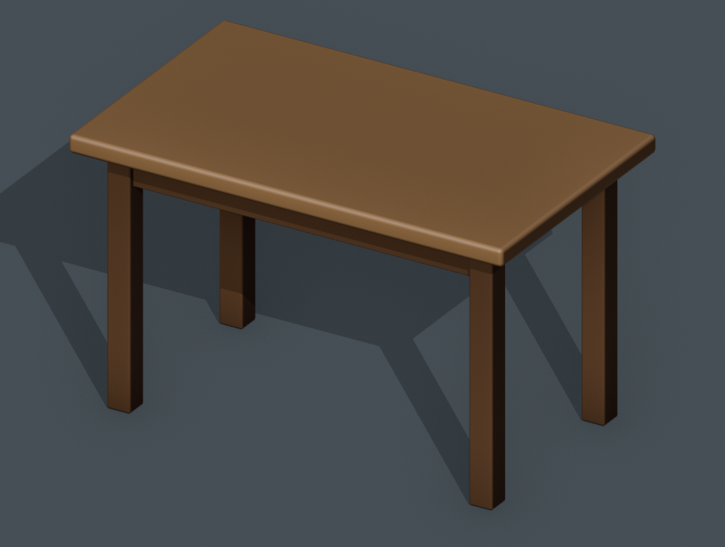

# 2. Table

**Temps indicatif** 75–120 min.

## Objectif

Construire un meuble stable en contrôlant les appuis et les assemblages.

## Résultat attendu

Un plateau de 1,20 × 0,72 m à 0,74 m du sol, quatre pieds et deux traverses apparentes.

Ce visuel est un rendu de comparaison réalisé dans Blender. Le résultat se contrôle également en vue Solid et en filaire.

[Scène Blender de comparaison](assets/table.blend)

## Outils

`N` · `G` · `S` · `Ctrl+A` · `Shift+D` · `Ctrl+B`. Raccourcis de la keymap Blender par défaut.

## Erreurs fréquentes

Vérifiez chaque pied de profil. Un pied qui ne rejoint pas le plateau ou flotte donne un mauvais assemblage.

## Tutoriel dans Blender

### plateau — Définir la hauteur avec le plateau

Créez un cube de dimensions 1,20 / 0,72 / 0,05 m. Réglez son centre à Z=0,715 m. Appliquez l’échelle. Le dessous à Z=0,69 m fixe la hauteur des pieds.

**Vérification** La face supérieure est à Z=0,74 m.

### appuis — Placer et dupliquer les pieds

Créez un pied de 0,065 × 0,065 × 0,69 m. Mettez-le à X=-0,50, Y=-0,26, Z=0,345. Dupliquez avec `Shift+D X 1` puis reproduisez la paire en `Y 0.52`.

**Vérification** Les quatre bases sont à Z=0 et les pieds prennent sous le plateau.

### traverses — Donner une raison aux traverses

Ajoutez deux traverses de 1,00 × 0,035 × 0,09 m sous les longs côtés, centrées à Z=0,645 m. Les traverses relient les pieds et affinent la silhouette sous le bord.

**Vérification** En vue de dessous, chaque traverse rejoint les deux pieds.

### controle — Comparer les biseaux et refaire l’implantation

Appliquez les échelles puis ajoutez de petits biseaux au plateau et aux pieds. Créez une table console de 0,95 × 0,35 m en recalculant les positions des appuis.

**Vérification** Captures en trois-quarts et en profil. Vérifiez la hauteur et les quatre contacts.

