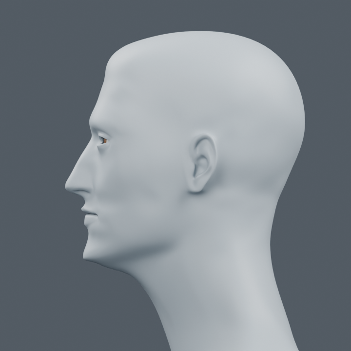

# 8. Visage humain

**Temps indicatif** 3–6 h.

## Objectif

Construire un visage continu avec des repères anatomiques et des boucles fonctionnelles.

## Résultat attendu

Un visage neutre de face, de profil et en trois-quarts, avec yeux intégrés aux orbites et silhouette de mâchoire lisible.

Ce visuel est un rendu de comparaison réalisé dans Blender. Le résultat se contrôle également en vue Solid et en filaire.

[Buste anatomique éditable pour la comparaison](../../PROPOSITIONS/RECONSTRUCTION_2_VUES/visage_recale.blend)

## Outils

`Mirror` · `E` · `G` · `Ctrl+R` · `Merge` · `Subdivision Surface`. Raccourcis de la keymap Blender par défaut.

## Erreurs fréquentes

Une sphère qui flotte devant l’orbite et des lèvres ajoutées comme des tubes restent visibles de profil. Reprenez la surface avant les détails.

## Tutoriel dans Blender

### repere — Placer les repères

Tracez ligne des yeux, base du nez, commissures, menton et tragus sur les deux images. En vue de profil, notez quel point avance le plus entre front, nez, bouche et menton.

**Vérification** Les repères correspondants ont des hauteurs compatibles.

### crane — Faire tenir le crâne en profil

Construisez un demi-volume avec des sections autour du front, du maxillaire et du cou. Reliez ces sections avec `E` et placez les bords médians sur X=0.

**Vérification** Le menton et la nuque sont connectés dans la même cage.

### orbite — Organiser l’œil et la bouche

Créez des boucles autour de l’orbite et de la bouche. Placez un globe distinct en retrait, prolongez la paupière autour du globe et tirez les sommets du nez depuis la surface du visage. Façonnez une oreille simple sur la silhouette latérale.

**Vérification** Le globe est entouré de peau. Les contours restent lisibles en filaire et sans matériau.

### preuve — Rendre puis refaire une modification

Comparez votre visage en argile à la référence. Sur une copie, changez les pommettes ou la mâchoire sans changer la ligne des yeux. Le [détail de méthode](hum-visage.md) approfondit les boucles.

**Vérification** Montrez un avant et après sous une caméra identique. L’illustration est un buste de vérification anatomique, pas une capture du tutoriel.

