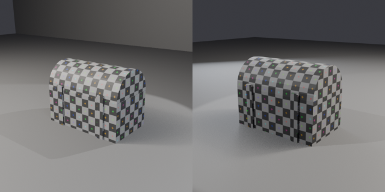

# CH04.01 — Tutoriels pas à pas

Ouvrez `STARTER_FILES/ch04_01_chest_starter.blend` : `PROP_Chest` (corps, couvercle, deux sangles) avec un damier (UV Grid). Espace de travail **UV Editing** (onglet en haut de la fenêtre).
Sauvegardez sous `ch04_01_chest_<prenom>_v001.blend`.

## Tutoriel 1 — Diagnostiquer (10 min)
Rendu / vue Material Preview : des **bandes** sur les flancs = étirement. Dans l'éditeur UV, tous les îlots sont superposés au milieu du carré. Lancez le correcteur (tutoriel 6) : étirement moyen 1,59, chevauchement, occupation 12 %.

## Tutoriel 2 — Marquer les seams (30 min)
Edit Mode, mode arête (2). Sélectionnez les arêtes vives : *Select > Select Sharp Edges* (angle ≈ 50°). Puis *Edge > Mark Seam* (menu Edge, ou Ctrl+E). Les arêtes d'une surface courbe ne se marquent pas.
Vérifiez que les coutures rouges séparent le corps, le couvercle et les sangles aux endroits voulus. Sur une sangle encore fermée en boucle, marquez aussi une couture transversale discrète pour que l’îlot puisse s’ouvrir.

## Tutoriel 3 — Déplier (10 min)
Tout sélectionner (A). *UV > Unwrap* : essayez **Unwrap Angle Based** puis **Unwrap Conformal** ; comparez le damier. Gardez Angle Based si les carrés sont réguliers.

## Tutoriel 4 — Égaliser la densité (10 min)
Éditeur UV : tout sélectionner (A), *UV → Average Island Scale*. Comparez la taille des carrés entre le corps, le couvercle et les sangles. L’échelle moyenne doit se rapprocher entre îlots. Si les carrés sont encore déformés à l’intérieur d’un îlot, reprenez ses coutures ou son dépliage.

## Tutoriel 5 — Packer (15 min)
*UV > Pack Islands* ; dans le panneau de l'opérateur : *Rotate* coché, *Margin* ≈ 0,02. Tout doit tenir dans [0, 1] sans chevauchement, en occupant au moins la moitié du carré.

## Tutoriel 6 — Vérifier
```powershell
& "C:\Program Files\Blender Foundation\Blender 5.3\blender.exe" -b --factory-startup `
  "STARTER_FILES\ch04_01_chest_<prenom>_v001.blend" `
  --python-exit-code 1 --python "SCRIPTS\validate_ch04_01.py" -- --exercise uv --render
```
Ajoutez `--debug` pour les grandeurs brutes. Références : `ch04_01_chest_reference.png` (damier, deux vues) et `ch04_01_chest_uv_layout.png` (disposition UV).

Remarque d'honnêteté : la solution est produite par script avec les MÊMES opérateurs que ceux de l'interface (`uv.unwrap`, `uv.average_islands_scale`, `uv.pack_islands`), qui fonctionnent en arrière-plan ;
les seams y sont posés automatiquement (angle > 50°) alors que vous les choisirez à la main.

## Référence à comparer



Comparez la taille du damier sur les flancs et le couvercle. Contrôlez séparément l’orientation des carrés et leur taille apparente.

[Vérifier la disposition UV](COMPLETED_EXAMPLES/ch04_01_chest_uv_layout.png)

## Variante de contrôle

Sur une boîte de contrôle, marquez une seule couture de plus, puis refaites le dépliage et réappliquez le damier. Comparez les faces qui étaient étirées et la nouvelle ligne de raccord. La couture change les îlots. Le motif permet de vérifier si la déformation a réellement baissé. **Preuve** Deux vues au même cadre avec la couture et l’endroit où le damier change.
