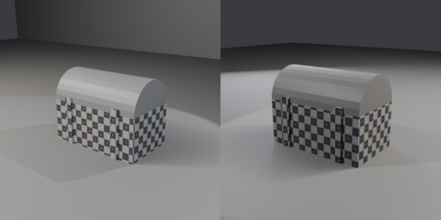

# CH04.02 — Tutoriels pas à pas

Ouvrez `STARTER_FILES/ch04_02_udim_starter.blend` : `PROP_Chest` aux UV propres (CH04.01) mais **tout dans la tuile 1001**, avec un matériau `MAT_UDIM` dont l'image `UDIM_Grid` possède les tuiles 1001 et 1002.
Sauvegardez sous `ch04_02_udim_<prenom>_v001.blend`. Espace de travail UV Editing.

## Tutoriel 1 — Lire les groupes (10 min)
Edit Mode, Properties > Material : deux emplacements ; sélectionnez l'index 1 puis *Select* : ce sont les faces du couvercle (index 0 : corps et sangles).

## Tutoriel 2 — Packer chaque groupe (30 min)
En mode Édition, désactivez *UV Sync Selection*. Dans la vue 3D, désélectionnez tout, choisissez l’emplacement 0 et cliquez sur *Select*. Dans l’éditeur UV, sélectionnez les îlots visibles et lancez *Pack Islands* vers la tuile 1001. Répétez depuis une sélection vide avec l’emplacement 1. L’empilement des deux groupes dans 1001 est provisoire.

## Tutoriel 3 — Déplacer le couvercle (10 min)
Laissez uniquement les faces du groupe 1 visibles dans l’éditeur UV. Sélectionnez leurs UV, puis faites `G`, `X`, `1`, `Entrée` pour les décaler d’une unité en U. Resélectionnez toutes les faces dans la vue 3D et vérifiez que le corps occupe 1001, le couvercle 1002 et qu’aucun îlot ne traverse la séparation.

## Tutoriel 4 — L'image UDIM (15 min)
Matériau `MAT_UDIM` : le nœud Image Texture est déjà en *UDIM Tiles*. Pour une image neuve : *Image > New* avec **Tiled** coché, puis *UDIM Tiles > Add Tile* pour 1002.

## Tutoriel 5 — Contrôler (10 min)
Material Preview : le damier du couvercle est 1,5× plus fin que celui du corps (densité plus forte).

## Tutoriel 6 — Vérifier
```powershell
& "C:\Program Files\Blender Foundation\Blender 5.3\blender.exe" -b --factory-startup `
  "STARTER_FILES\ch04_02_udim_<prenom>_v001.blend" `
  --python-exit-code 1 --python "SCRIPTS\validate_ch04_02.py" -- --exercise udim --render
```
Ajoutez `--debug` pour les mesures par tuile. Références : `ch04_02_udim_reference.png` et `ch04_02_udim_uv_layout.png` (deux tuiles côte à côte ; jaune : corps, bleu : couvercle).

Remarque d'honnêteté : la solution est produite par script (opérateurs réels `uv.pack_islands` par groupe, translation de +1 en U) ; les libellés d'interface cités n'ont pas été tous vérifiés dans les sources 5.3 (voir RESOURCES.md).

## Référence à comparer



Repérez le couvercle dans la seconde tuile et vérifiez que ses îlots restent dans cette tuile. La taille des cases doit être lisible sur le modèle.

[Vérifier la disposition UV](COMPLETED_EXAMPLES/ch04_02_udim_uv_layout.png)

## Variante de contrôle

Avant Pack Islands, relevez la tuile de chaque groupe et la destination des images. Faites le packing sur une copie. Vérifiez ensuite les marges au pixel pour la résolution visée et comparez les groupes qui partagent une texture. **Preuve** La tuile, le nom des images et les zones par matériau restent cohérents après réouverture.
