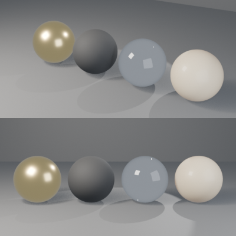

# CH04.03 — Tutoriels pas à pas

Ouvrez `STARTER_FILES/ch04_03_pbr_starter.blend` : quatre sphères (SPH_Metal, SPH_Rubber, SPH_Glass, SPH_Wax) dont les matériaux MAT_* sont des Principled BSDF par défaut (gris 0,8 ; rugosité 0,5). Un monde gris-bleu clair fournit le reflet.
Sauvegardez sous `ch04_03_pbr_starter_<prenom>_v001.blend`. Espace de travail Shading, vue Material Preview.

## Tutoriel 1 — L'or (20 min)
Sélectionnez SPH_Metal. Dans l'éditeur de matériau, Principled BSDF : *Metallic* 1 ; *Base Color* (1,00 ; 0,77 ; 0,34) ; *Roughness* 0,25. Observez le reflet de l'environnement.

## Tutoriel 2 — Le caoutchouc (15 min)
SPH_Rubber : *Metallic* 0 ; *Base Color* gris 0,05 ; *Roughness* 0,75. Comparez les trois valeurs à éclairage fixe. Les extrêmes servent de témoins. Revenez à 0,05 pour le caoutchouc sombre de cet exercice.

## Tutoriel 3 — Le verre (20 min)
SPH_Glass : *Metallic* 0 ; *Transmission Weight* 1 ; *Roughness* 0,02 ; *IOR* 1,5. Faites varier l’IOR de 1,0 à 2,0 à cadrage fixe en Cycles et regardez le fond au travers de la sphère. Revenez à 1,5 avant la vérification.

## Tutoriel 4 — La cire (25 min)
SPH_Wax : *Base Color* (0,85 ; 0,70 ; 0,48) ; *Roughness* 0,45 ; dans le panneau Subsurface : *Weight* 0,6, *Radius* (1 ; 0,5 ; 0,25), *Scale* 0,05 ; dans Coat : *Weight* 0,2. Une cire « blanche pure » (Base Color 1) est refusée.

## Tutoriel 5 — Contrôler
Rendu EEVEE ou Cycles depuis la caméra CAM_Front, puis CAM_High : regardez l'image, ne vous fiez pas qu'aux valeurs.

## Tutoriel 6 — Vérifier
```powershell
& "C:\Program Files\Blender Foundation\Blender 5.3\blender.exe" -b --factory-startup `
  "STARTER_FILES\ch04_03_pbr_starter_<prenom>_v001.blend" `
  --python-exit-code 1 --python "SCRIPTS\validate_ch04_03.py" -- --exercise pbr --render
```
Ajoutez `--debug` pour afficher les valeurs lues. Référence : `ch04_03_pbr_reference.png` (deux vues).

Remarque d'honnêteté : la solution est générée par script (valeurs lues sur les entrées du nœud) et le rendu a été regardé : or à reflets, caoutchouc mat, verre transparent, cire translucide. Les libellés de panneaux (Subsurface, Coat…) suivent les noms d'entrées vérifiés dans l'API 5.3 ; l'ordre exact des panneaux dans l'interface n'a pas été relu.

## Référence à comparer



Repérez les reflets de l’or, le fond vu à travers le verre et les transitions de lumière de la cire.

## Variante de contrôle

Comparez l’or et le caoutchouc dans une seule scène et sous la même lumière. Modifiez d’abord seulement Metallic, puis seulement Roughness. L’environnement se reflète plus ou moins nettement selon les paramètres. **Preuve** Une planche relie chaque changement à un reflet identifiable et garde la couleur de base comme témoin.
