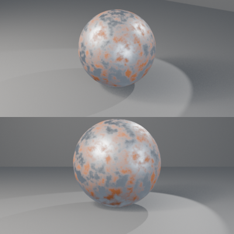

# CH04.04 — Tutoriels pas à pas

Ouvrez `STARTER_FILES/ch04_04_nodes_starter.blend` : sphère `SPH_Rust`, matériau `MAT_RustyMetal` réduit à un Principled BSDF relié à la sortie. Sauvegardez sous `ch04_04_nodes_starter_<prenom>_v001.blend`. Espace de travail Shading ; éditeur de nœuds en Shader Editor.

## Tutoriel 1 — Lire un graphe (10 min)
Repérez le Principled BSDF et le Material Output. Suivez le lien BSDF → Surface.

## Tutoriel 2 — Coordonnées et bruit (25 min)
Ajoutez (Add > Input > Texture Coordinate), (Add > Vector > Mapping), (Add > Texture > Noise Texture). Reliez la sortie *Object* à *Vector* de Mapping, puis sa sortie *Vector* à celle d’entrée de Noise Texture. Réglez *Scale* à 6 et *Detail* à 8. Faites varier uniquement *Scale* pour observer la taille des plaques.

## Tutoriel 3 — Le masque (20 min)
Ajoutez une Color Ramp (Add > Converter) : sortie Fac du bruit vers la rampe. Stop 0 : blanc à 0,45 ; stop 1 : noir à 0,62. Resserrer les stops donne des plaques nettes.

## Tutoriel 4 — Couleur (15 min)
Ajoutez un nœud Mix, type de données Color. A = rouille (0,45 ; 0,15 ; 0,05), B = acier (0,50 ; 0,52 ; 0,55). Rampe → Factor, Result → Base Color. Vérifiez les extrêmes en testant provisoirement un facteur à 0 puis à 1. Le noir sélectionne A, le blanc sélectionne B. Rétablissez la connexion ensuite.

## Tutoriel 5 — Metallic et Roughness (15 min)
Rampe → Metallic. Bruit → Map Range (From 0,3–0,7, To 0,25–0,85) → Roughness.

## Tutoriel 6 — Nettoyer et vérifier
Supprimez tout nœud inutilisé. Rendu depuis les deux caméras, puis :
```powershell
& "C:\Program Files\Blender Foundation\Blender 5.3\blender.exe" -b --factory-startup `
  "STARTER_FILES\ch04_04_nodes_starter_<prenom>_v001.blend" `
  --python-exit-code 1 --python "SCRIPTS\validate_ch04_04.py" -- --exercise nodes --render
```
`--debug` affiche les types en amont de chaque entrée. Référence : `ch04_04_nodes_reference.png`.

Remarque d'honnêteté : la solution est générée par script (création de nœuds et de liens par l'API) ; son rendu a été regardé : acier clair et plaques rouille orangées, cohérent sur les deux vues. Les chemins de menu du Add (Input, Vector, Texture, Converter) sont les catégories habituelles mais n'ont pas été relus dans les sources 5.3 : utilisez la recherche (Shift+A puis taper le nom).

## Référence à comparer



Comparez la silhouette des plaques de rouille au masque de la rampe. Vérifiez que les zones rouillées correspondent au matériau brun mat.

## Variante de contrôle

Suivez les liens depuis Material Output jusqu’aux coordonnées. Débranchez un seul fil dans une copie et notez l’effet. Reconnectez le bon type de sortie au bon socket. **Preuve** Le changement observé correspond à la branche isolée, et le graphe de référence est retrouvé sans comparer les noms de nœuds seulement.
