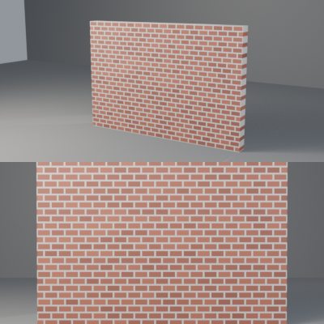

# CH04.05 — Tutoriels pas à pas

Ouvrez `STARTER_FILES/ch04_05_procedural_starter.blend` : `PROP_Wall` avec `MAT_Brick` (Principled par défaut). Sauvegardez sous `ch04_05_procedural_starter_<prenom>_v001.blend`. Espace de travail Shading.

## Tutoriel 1 — Coordonnées (10 min)
Ajoutez Texture Coordinate (Shift+A, recherche) et une Brick Texture ; reliez **Object** → Vector.

## Tutoriel 2 — Briques (25 min)
Scale 3 ; Mortar Size 0,03 ; Mortar Smooth 0,1. Color1 (0,35 ; 0,10 ; 0,06), Color2 (0,22 ; 0,07 ; 0,05), Mortar (0,55 ; 0,52 ; 0,47). Brick [Color] → Base Color. Roughness 0,8.

## Tutoriel 3 — Décalage (10 min)
Dans les propriétés du nœud, Offset 0,5 (essayez 0 puis revenez à 0,5).

## Tutoriel 4 — Joints en creux (20 min)
Ajoutez un nœud Bump : Brick [Fac] → Height ; Bump [Normal] → Normal du Principled. Strength 0,8, Distance 0,02. Dans la sortie *Fac*, le mortier correspond aux valeurs hautes. Comparez le sens du relief sous une lumière rasante et activez *Invert* sur le nœud Bump pour que ces joints paraissent creux. Coupez la connexion *Normal* un instant pour isoler l’effet du relief de celui de la couleur.

## Tutoriel 5 — Contrôler
Rendu depuis les deux caméras ; supprimez tout nœud orphelin.

## Tutoriel 6 — Vérifier
```powershell
& "C:\Program Files\Blender Foundation\Blender 5.3\blender.exe" -b --factory-startup `
  "STARTER_FILES\ch04_05_procedural_starter_<prenom>_v001.blend" `
  --python-exit-code 1 --python "SCRIPTS\validate_ch04_05.py" -- --exercise procedural --render
```
Référence : `ch04_05_procedural_reference.png`.

Remarque d'honnêteté : la solution est générée par script et son rendu a été regardé (briques rouges, joints clairs, rangées décalées, deux vues). Le relief du bump est discret à cette distance ; zoomez pour le voir. Chemins de menu non relus dans les sources 5.3 : utilisez la recherche Shift+A.

## Référence à comparer



Comparez le décalage des rangées et l’épaisseur des joints dans les deux cadrages. Pour juger le sens du relief, faites aussi un essai sous lumière rasante.

## Variante de contrôle

Comparez le motif sur deux surfaces de tailles différentes en utilisant la même source de coordonnées. Identifiez si la différence d’échelle dépend de l’objet ou des coordonnées. Mesurez la largeur visuelle de trois briques et le décalage d’un rang. **Preuve** Les dimensions choisies restent explicables après le changement d’échelle.
