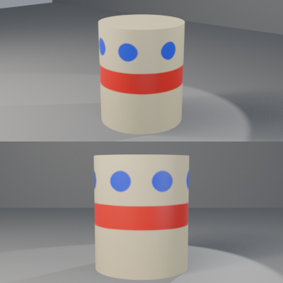

# CH04.06 — Tutoriels pas à pas

Ouvrez `STARTER_FILES/ch04_06_painting_starter.blend` : `PROP_Can` (UV automatiques du cylindre), matériau `MAT_Can` dont Base Color vient de l'image `T_Can` (512 × 512, crème, empaquetée). Sauvegardez sous `ch04_06_painting_starter_<prenom>_v001.blend`.

## Tutoriel 1 — Passer en Texture Paint (10 min)
Sélectionnez la boîte ; menu des modes de la vue 3D : **Texture Paint**. Choisissez le pinceau *Paint Hard* dans la barre d'outils ou la liste des pinceaux.

## Tutoriel 2 — La bande (30 min)
Vue de face orthographique (pavé numérique 1). Couleur rouge (0,80 ; 0,08 ; 0,06) saisie dans le sélecteur de couleur ; taille ≈ 45 px. Tracez une ligne à mi-hauteur sur ±0,4 m. Orientez-vous successivement avec `Numpad 1`, `Numpad 3`, `Ctrl+Numpad 1` et `Ctrl+Numpad 3`. Raccordez chaque trait à mi-hauteur au précédent. Inspectez la couture en faisant le tour avant de peindre les pastilles.

## Tutoriel 3 — Les pastilles (20 min)
Couleur bleue (0,10 ; 0,20 ; 0,80), taille ≈ 36 px, petits cercles ; trois à cinq pastilles autour de la boîte.

## Tutoriel 4 — Empaqueter (10 min)
Dans l’éditeur d’images, vérifiez que les traits sont bien sur `T_Can`. Utilisez *Image → Pack* si l’image est externe, puis enregistrez le .blend. Fermez et rouvrez votre copie pour vérifier que les traits sont conservés.

## Tutoriel 5 — Vérifier
```powershell
& "C:\Program Files\Blender Foundation\Blender 5.3\blender.exe" -b --factory-startup `
  "STARTER_FILES\ch04_06_painting_starter_<prenom>_v001.blend" `
  --python-exit-code 1 --python "SCRIPTS\validate_ch04_06.py" -- --exercise painting --debug
```
`--debug` affiche le fond, la couverture, les familles de couleur et la part hors UV. Référence : `ch04_06_painting_reference.png`.

Remarque d'honnêteté : la solution a été peinte pour de vrai avec l'opérateur `paint.image_paint` dans Blender 5.2 (traits générés par script avec des coordonnées d'écran calculées à partir de la vue ; la souris n'a pas été utilisée), puis validée en 5.3. Les raccourcis (pavé numérique) sont les raccourcis standard de la vue 3D ; non relus dans la keymap 5.3 pour ce chapitre.

## Référence à comparer



Vérifiez que la bande reste continue dans les deux cadrages et que les pastilles restent distinctes du fond.

## Variante de contrôle

Peignez sur une copie de l’image active. Repérez une couture UV à travers laquelle passe la bande. Sauvegardez l’image séparément ou empaquetez-la selon le mode de livraison, puis rouvrez le fichier. **Preuve** La couleur survit à la réouverture, et la bande est vérifiée sur les deux côtés de la couture.
