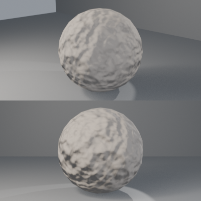

# CH04.07 — Tutoriels pas à pas

Ouvrez `STARTER_FILES/ch04_07_baking_starter.blend` : `HIGH_Rock` (relief), `LOW_Rock` (320 faces, UV) et `T_Rock_N` (plate, Non-Color) déjà branchée par un Normal Map. Sauvegardez sous `ch04_07_baking_starter_<prenom>_v001.blend`.

## Tutoriel 1 — Lire le matériau (10 min)
Shader Editor sur LOW_Rock : Image Texture → Normal Map → Normal. Cliquez le nœud Image Texture qui contient `T_Rock_N` pour le rendre actif. Vérifiez *Non-Color* et confirmez que le nœud Normal Map utilise l’espace tangent.

## Tutoriel 2 — Préparer (10 min)
Properties > Render : moteur **Cycles**. Panneau **Bake** : Bake Type **Normal**, Space **Tangent**. Sous-panneau **Selected to Active** : coché, Extrusion 0,25 m. Sous-panneau **Margin** : 16 px.

## Tutoriel 3 — Sélection (5 min)
En mode Objet, sélectionnez `HIGH_Rock` en premier puis ajoutez `LOW_Rock` en dernier. Vérifiez que les deux sont sélectionnés et que `LOW_Rock` est l’objet actif. C’est son image qui reçoit le bake.

## Tutoriel 4 — Baker (5 min)
Bouton **Bake**. En fin de calcul l'image `T_Rock_N` porte le relief ; repassez en EEVEE pour voir le résultat.

## Tutoriel 5 — Finaliser (10 min)
Cachez HIGH_Rock au rendu. Empaquetez T_Rock_N (Image > Pack). Enregistrez.

## Tutoriel 6 — Vérifier
```powershell
& "C:\Program Files\Blender Foundation\Blender 5.3\blender.exe" -b --factory-startup `
  "STARTER_FILES\ch04_07_baking_starter_<prenom>_v001.blend" `
  --python-exit-code 1 --python "SCRIPTS\validate_ch04_07.py" -- --exercise baking --debug
```
Référence : `ch04_07_baking_reference.png` (deux vues : silhouette à facettes, relief fin).

Remarque d'honnêteté : la solution a été bakée en arrière-plan avec l'opérateur `object.bake` réel (Blender 5.3) ; le rendu a été regardé. L'ordre de sélection dans l'Outliner et l'emplacement exact du bouton sont ceux de l'interface standard, non rejoués à la souris.

## Référence à comparer



Comparez la silhouette à facettes du rocher et la variation de lumière à l’intérieur de cette silhouette. Le bake restitue des détails d’ombrage.

## Variante de contrôle

Testez la sortie de bake sur une copie et sélectionnez le nœud image de destination avant de calculer. Comparez l’image seule avec le résultat du matériau. Refaire le bake à une marge différente doit affecter les bords des îlots, pas le motif central. **Preuve** L’image d’origine, l’image générée, les paramètres et le fichier de reprise sont identifiés.
