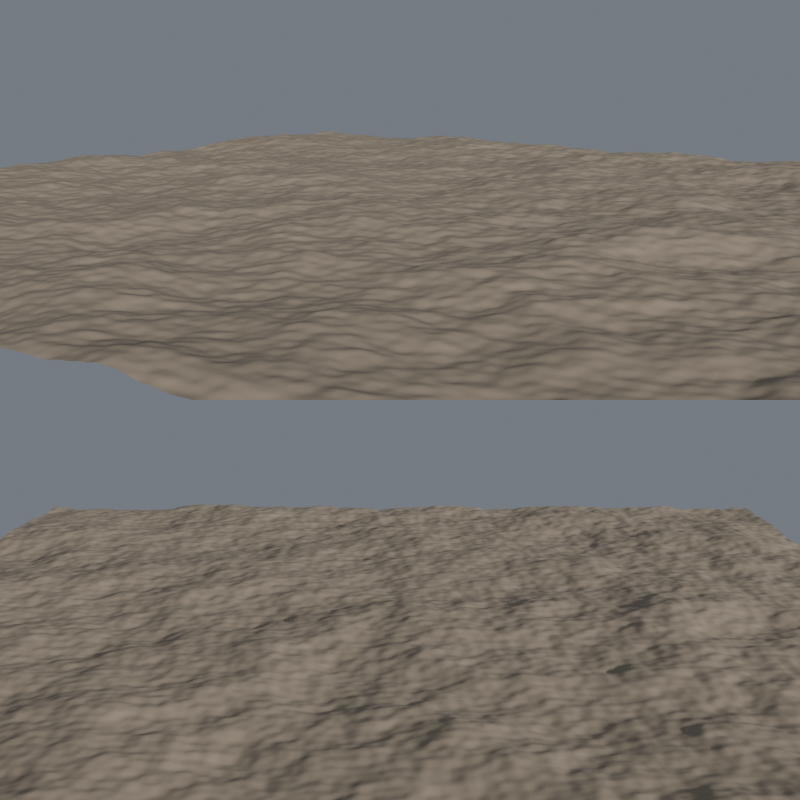

# CH04.08 — Tutoriels pas à pas

Ouvrez `STARTER_FILES/ch04_08_relief_starter.blend` : `PROP_Ground` (plan 6 × 6 m, une face), matériau `MAT_Ground` (Principled), soleil rasant `SUN_Low`, moteur EEVEE. Sauvegardez sous `ch04_08_relief_starter_<prenom>_v001.blend`.

## Tutoriel 1 — Moteur (5 min)
Render Properties : Render Engine **Cycles**.

## Tutoriel 2 — Le graphe (25 min)
Shader Editor : Texture Coordinate [Object] → Noise Texture (Scale 0,9 ; Detail 4 ; Roughness 0,55) → Displacement [Height] ; Midlevel 0,5 ; Scale 0,25. Displacement [Displacement] → Material Output [Displacement].

## Tutoriel 3 — Méthode du matériau (5 min)
Material Properties > Settings : **Displacement** = Displacement Only (ou Displacement and Bump).

## Tutoriel 4 — Subdiviser (10 min)
Modifier Properties > Add Modifier > Generate > Subdivision Surface ; type **Simple** ; réglez *Render* sur 6 pour l’essai de référence. Chaque niveau divise un quad en quatre, donc une face produit 4 096 quads au niveau 6. Gardez la subdivision adaptative comme variante à comparer au même cadrage.

## Tutoriel 5 — Regarder
Rendu depuis `CAM_Low` (caméra rasante) : la ligne d'horizon du sol ondule ; comparez avec Bump Only (la silhouette redevient droite).

## Tutoriel 6 — Vérifier
```powershell
& "C:\Program Files\Blender Foundation\Blender 5.3\blender.exe" -b --factory-startup `
  "STARTER_FILES\ch04_08_relief_starter_<prenom>_v001.blend" `
  --python-exit-code 1 --python "SCRIPTS\validate_ch04_08.py" -- --exercise relief --debug
```
Référence : `ch04_08_relief_reference.png` (rendu Cycles, 24 échantillons, sans débruitage).

Remarque d'honnêteté : la solution est générée par script et son rendu Cycles a été regardé (silhouette ondulante, relief visible). Le menu d'ajout du modificateur et le libellé exact de l'option adaptative n'ont pas été relus dans l'interface 5.3 (modificateur défini en C : propriété `use_adaptive_subdivision` seulement vérifiée par l'API).

## Référence à comparer



Suivez la silhouette rasante du sol. Un déplacement réel y modifie le contour et l’angle local de la surface.

## Variante de contrôle

Comparez Bump et déplacement sur le même motif à deux cadrages, dont un de profil. Le relief d’ombrage modifie l’éclairage apparent. Le déplacement géométrique peut changer la silhouette quand le moteur et le maillage le permettent. **Preuve** La comparaison de profil situe le seuil à partir duquel l’effet doit déplacer la surface.
