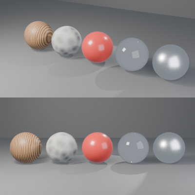

# CH04.09 — Tutoriels pas à pas

Ouvrez `STARTER_FILES/ch04_09_materials_starter.blend` : cinq sphères (SPH_Wood, SPH_Stone, SPH_Plastic, SPH_Glass, SPH_Steel) avec leurs matériaux Principled par défaut. Sauvegardez sous `ch04_09_materials_starter_<prenom>_v001.blend`.

## Tutoriel 1 — Bois (40 min)
Texture Coordinate [Object] → Mapping (Scale 1 ; 1 ; 0,15) → Wave Texture (Bands ; Scale 6 ; Distortion 4 ; Detail 3) → Color Ramp (stop 0 en 0,2 : (0,20 ; 0,09 ; 0,04) ; stop 1 en 0,8 : (0,50 ; 0,30 ; 0,15)) → Base Color. Roughness 0,45.

## Tutoriel 2 — Pierre (40 min)
Voronoi (Scale 4) [Distance] → Color Ramp (gris sombre → gris clair) → Base Color. Noise (Scale 18 ; Detail 8) → Bump (Strength 0,6) → Normal. Roughness 0,85.

## Tutoriel 3 — Plastique (15 min)
Base Color (0,80 ; 0,05 ; 0,04) ; Roughness 0,3 ; Coat Weight 0,5.

## Tutoriel 4 — Verre (10 min)
Transmission Weight 1 ; Roughness 0,02 ; IOR 1,5.

## Tutoriel 5 — Acier brossé (40 min)
Metallic 1 ; Base Color (0,75 ; 0,76 ; 0,78) ; Anisotropic 0,6. Déplacez la source lumineuse et repérez l’étirement du reflet. Conservez la même orientation du motif quand vous comparez deux rugosités. Texture Coordinate → Mapping (Scale 1 ; 60 ; 1) → Noise (Scale 8) → Map Range (To Min 0,2 ; To Max 0,45) → Roughness.

## Tutoriel 6 — Publier (15 min)
Pour chaque matériau : **Mark as Asset**, description (« Bois à veines… »), tag. Enregistrez.

## Tutoriel 7 — Vérifier
```powershell
& "C:\Program Files\Blender Foundation\Blender 5.3\blender.exe" -b --factory-startup `
  "STARTER_FILES\ch04_09_materials_starter_<prenom>_v001.blend" `
  --python-exit-code 1 --python "SCRIPTS\validate_ch04_09.py" -- --exercise materials --debug
```
Référence : `ch04_09_materials_reference.png`.

Remarque d'honnêteté : la solution est générée par script (valeurs du tableau de THEORY.md §1) ; le rendu a été regardé : bois à veines, pierre grise, plastique rouge, verre, acier — les cinq se distinguent. Le plastique paraît un peu rosé (reflet de l'environnement clair). L'acier brossé reste discret à cette distance ; l'anisotropie se voit surtout sous une lumière ponctuelle. Chemins de menu non relus.

## Référence à comparer



Repérez pour chaque matière un indice visible. Cherchez notamment l’orientation des veines du bois et l’allongement du reflet de l’acier.

## Variante de contrôle

Choisissez une face du bois ou de la pierre où le matériau paraît trop répétitif. Définissez deux échelles indépendantes, veines et pores par exemple, et changez-les séparément. Gardez lumière et caméra fixes. **Preuve** Les deux passages isolent une fréquence de détails et montrent leur fonction dans le plan.
