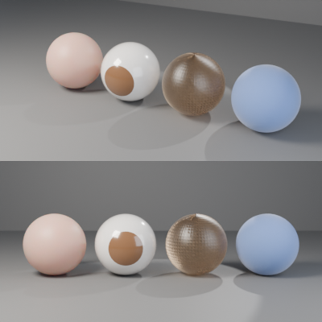

# CH04.10 — Tutoriels pas à pas

Ouvrez `STARTER_FILES/ch04_10_character_starter.blend` : quatre sphères (SPH_Skin, SPH_Eye, SPH_Hair, SPH_Cloth), matériaux Principled par défaut. Sauvegardez sous `ch04_10_character_starter_<prenom>_v001.blend`. Moteur : **Cycles**.

## Tutoriel 1 — Peau (40 min)
Base Color (0,65 ; 0,42 ; 0,34) ; Roughness 0,45. Panneau **Subsurface** : Weight 1 ; Radius (1 ; 0,2 ; 0,1) ; Scale 0,05. Noise (Scale 250) → Bump (Strength 0,15 ; Distance 0,005) → Normal.

## Tutoriel 2 — Œil (45 min)
Texture Coordinate [Object] → Mapping (Rotation Z 90°) → Gradient Texture (Linear) → Color Ramp (interpolation *Constant* ; stop 0 clair (0,85 ; 0,82 ; 0,78) ; stop à 0,42 brun (0,22 ; 0,10 ; 0,04)) → Base Color. Roughness 0,2 ; panneau **Coat** : Weight 1, Roughness 0,02.

## Tutoriel 3 — Cheveux (20 min)
Supprimez le Principled BSDF ; ajoutez le **Principled Hair BSDF** (modèle Chiang, paramétrage Color) : Color (0,12 ; 0,06 ; 0,03), Roughness 0,3 ; reliez BSDF → Surface.

## Tutoriel 4 — Tissu (30 min)
Base Color bleu (0,15 ; 0,25 ; 0,55) ; Roughness 0,8 ; panneau **Sheen** : Weight 0,5, Roughness 0,5. Wave (Bands, Scale 120) → Bump (Strength 0,4) → Normal.

## Tutoriel 5 — Regarder
Faites deux rendus Cycles depuis le même cadrage. Comparez le réglage de peau de l’exercice à une copie avec *Subsurface Weight* à zéro. Observez l’ombre sur la sphère avant de transférer le matériau à un visage. La sphère de l’œil évalue le matériau. Pour vérifier le regard d’un personnage, utilisez une scène avec deux yeux et leur orientation contrôlable.

## Tutoriel 6 — Vérifier
```powershell
& "C:\Program Files\Blender Foundation\Blender 5.3\blender.exe" -b --factory-startup `
  "STARTER_FILES\ch04_10_character_starter_<prenom>_v001.blend" `
  --python-exit-code 1 --python "SCRIPTS\validate_ch04_10.py" -- --exercise character --debug
```
Référence : `ch04_10_character_reference.png`.

Remarque d'honnêteté : la solution est générée par script et rendue en Cycles (96 échantillons, débruitage) ; le rendu a été regardé. Une première version avait l'iris décentré, la peau trop claire et du bruit : corrigés. Le panneau et les libellés (Subsurface, Coat, Sheen) suivent les noms d'entrées de l'API 5.3 ; l'ordre d'affichage dans l'interface n'a pas été relu.

## Référence à comparer



Comparez les transitions sur la peau et le reflet de l’œil. Gardez le même cadre et la même lumière pour attribuer les différences au matériau.

## Variante de contrôle

Comparez deux visages de test avec la même lumière. Sur une copie, modifiez seulement la contribution de diffusion sous la surface. Jugez les zones minces et la silhouette. Sur l’œil, comparez le reflet par rapport au globe, puis vérifiez la direction du regard avec le rig au neutre. **Preuve** Vous distinguez l’effet du shader de celui du modèle ou de la lumière.
