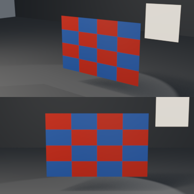

# CH04.11 — Tutoriels pas à pas

Ouvrez `STARTER_FILES/ch04_11_color_starter.blend` : planche `PLATE_Test` (damier rouge/bleu pour l'albedo, dégradé de rugosité, normale plate) et un panneau lumineux `EMIT_Panel`. Tout est volontairement mal réglé. Sauvegardez sous `ch04_11_color_starter_<prenom>_v001.blend`.

## Tutoriel 1 — Les images (15 min)
Shader Editor sur MAT_Plate : pour chaque nœud Image Texture, le menu **Color Space** : T_Albedo → **sRGB** ; T_Rough → **Non-Color** ; T_Normal → **Non-Color**.

## Tutoriel 2 — La vue (10 min)
Render Properties > **Color Management** : View Transform **AgX** ; Look *None* ; Exposure 0 ; Gamma 1 ; Display Device sRGB.

## Tutoriel 3 — La comparaison (15 min)
Rendez la vue Front en *Standard* puis en *AgX* : regardez le panneau lumineux (crème / blanc pur).

## Tutoriel 4 — La sortie (10 min)
Dans *Output Properties*, choisissez le type **Image**, puis **OpenEXR** et la profondeur 16 bits (*Half*). Enregistrez un PNG distinct pour prévisualiser l’image avec sa transformation d’affichage. L’EXR sert de référence linéaire pour la postproduction.

## Tutoriel 5 — Vérifier
```powershell
& "C:\Program Files\Blender Foundation\Blender 5.3\blender.exe" -b --factory-startup `
  "STARTER_FILES\ch04_11_color_starter_<prenom>_v001.blend" `
  --python-exit-code 1 --python "SCRIPTS\validate_ch04_11.py" -- --exercise color --debug
```
Référence : `ch04_11_color_reference.png`.

Remarque d'honnêteté : la solution est générée par script ; son rendu a été regardé (damier net, panneau crème tone-mappé) ; les valeurs de comparaison Standard/AgX ont été mesurées. Les noms des menus (Color Management, Color Space, View Transform, Look, Exposure, Gamma, Display Device) correspondent aux propriétés de l'API 5.3 ; l'emplacement exact des panneaux dans l'interface n'a pas été relu. Le panneau « Output Properties » et le choix « OpenEXR » sont ceux de `image_settings.file_format`.

## Référence à comparer



Vérifiez les couleurs du damier et la séparation des hautes lumières. Le choix des espaces des fichiers et la transformation de vue agissent à deux étapes différentes.

## Variante de contrôle

Utilisez la même image linéaire et exportez deux PNG avec deux réglages d’affichage. Conservez l’EXR comme témoin. Comparez la perception des hautes lumières et la valeur des références. **Preuve** Le rapport indique format, espace des textures, transformation d’affichage et réglages utilisés pour chaque image.
