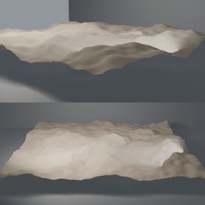

# CH05.01 — Tutoriels pas à pas

Ouvrez `STARTER_FILES/ch05_01_principles_starter.blend` : `GEO_Terrain` (maillage vide) avec un modificateur Geometry Nodes dont l'arbre `GN_Terrain` contient une Grid de 3 × 3 sommets reliée à la sortie. Sauvegardez sous `ch05_01_principles_starter_<prenom>_v001.blend`. Espace de travail **Geometry Nodes**.

## Tutoriel 1 — Lire l'arbre (10 min)
Sélectionnez `GEO_Terrain`. Dans le Geometry Node Editor : Grid → Group Output. Ouvrez le Spreadsheet : 9 sommets.

## Tutoriel 2 — La grille (10 min)
Grid : Size X = 10, Size Y = 10, Vertices X = 100, Vertices Y = 100. Spreadsheet : 10 000 sommets.

## Tutoriel 3 — Le champ (30 min)
Ajoutez Set Position entre Grid et Group Output. Ajoutez Noise Texture (Scale 0,35 ; Detail 5), Math (Subtract, 0,5), Math (Multiply, 2), Combine XYZ. Reliez Noise [Fac] → Subtract → Multiply → Combine XYZ [Z] → Set Position [Offset].

## Tutoriel 4 — Lisser et habiller (15 min)
Ajoutez Set Shade Smooth puis Set Material (choisissez MAT_Terrain), avant Group Output.

## Tutoriel 5 — Inspecter (15 min)
Spreadsheet : colonnes de position ; reliez la géométrie de *Set Position* à l’entrée *Geometry* d’un *Viewer* et le *Fac* du bruit à son entrée de valeur. Sélectionnez le Viewer dans le Spreadsheet et choisissez le domaine des points pour comparer la valeur à la coordonnée Z.

## Tutoriel 6 — Vérifier
```powershell
& "C:\Program Files\Blender Foundation\Blender 5.3\blender.exe" -b --factory-startup `
  "STARTER_FILES\ch05_01_principles_starter_<prenom>_v001.blend" `
  --python-exit-code 1 --python "SCRIPTS\validate_ch05_01.py" -- --exercise principles --debug
```
Référence : `ch05_01_principles_reference.png` (deux vues).

Remarque d'honnêteté : la solution est générée par script (nœuds et liens créés par l'API) ; la géométrie évaluée a été mesurée et le rendu regardé (un premier rendu sortait blanc faute de Set Material et le terrain était à moitié sous le sol : corrigés). Les chemins de menu de l'éditeur (Add > …) n'ont pas été relus : utilisez la recherche (Shift+A).

## Référence à comparer



Contrôlez que le relief se dessine autour du niveau du sol. Comparez la vue de côté au Spreadsheet des positions.

## Variante de contrôle

Sur la grille, changez une seule dimension puis le nombre de subdivisions, sur deux copies distinctes. Les deux réglages ne modifient pas la même chose. **Preuve** Notez la longueur et le compte de sommets dans chaque cas, puis retrouvez la connexion qui entraîne le changement.
