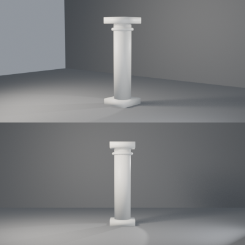

# CH05.02 — Tutoriels pas à pas

Ouvrez `STARTER_FILES/ch05_02_procedural_starter.blend` : `GEO_Column` avec un arbre `GN_Column` qui contient un Cylinder (Radius 0,3 ; Depth 2,6) relié à la sortie, sans Transform. Sauvegardez sous `ch05_02_procedural_starter_<prenom>_v001.blend`. Espace de travail Geometry Nodes.

## Tutoriel 1 — Poser le fût (15 min)
Ajoutez **Transform Geometry** après le Cylinder : Translation z = 1,5. Le fût va de 0,2 à 2,8 m (Spreadsheet ou vue de face).

## Tutoriel 2 — Base et chapiteau (20 min)
Ajoutez deux Cube (Size 0,9 × 0,9 × 0,2) et deux Transform (z = 0,1 et z = 2,9).

## Tutoriel 3 — L'anneau (30 min)
Ajoutez deux Curve Circle (Radius 0,33 et 0,05 ; Resolution 48 et 8). Curve to Mesh : Curve ← grand cercle, Profile Curve ← petit cercle. Transform z = 2,6.

## Tutoriel 4 — Assembler (15 min)
Join Geometry reçoit les quatre Transform. Puis Set Shade Smooth, Set Material (MAT_Column), Group Output.

## Tutoriel 5 — Contrôler (15 min)
Spreadsheet : bornes de Z. Dimensions réelles : hauteur 3 m, pieds sur z = 0.

## Tutoriel 6 — Vérifier
```powershell
& "C:\Program Files\Blender Foundation\Blender 5.3\blender.exe" -b --factory-startup `
  "STARTER_FILES\ch05_02_procedural_starter_<prenom>_v001.blend" `
  --python-exit-code 1 --python "SCRIPTS\validate_ch05_02.py" -- --exercise procedural --debug
```
Référence : `ch05_02_procedural_reference.png`.

Remarque d'honnêteté : la solution est générée par script ; la géométrie évaluée a été mesurée et le rendu regardé (colonne complète, deux vues). Une version de la caméra coupait le haut de la colonne : corrigée. Un contre-exemple (fût trop court) passait d'abord le correcteur : un contrôle de la hauteur du fût a été ajouté.

## Référence à comparer



Suivez les raccords de la base, du fût, du chapiteau et de l’anneau. Comparez leur ordre vertical aux quatre branches du graphe.

## Variante de contrôle

Faites une variante de colonne avec le même diamètre de fût à deux hauteurs. Contrôlez la position de base et de chapiteau avec une vue orthographique et des mesures. **Preuve** Le fût reste raccordé et vous pouvez identifier l’expression qui place la pièce supérieure après variation de hauteur.
