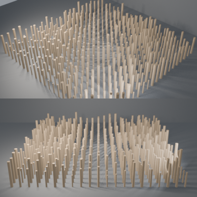

# CH05.03 — Tutoriels pas à pas

Ouvrez `STARTER_FILES/ch05_03_instances_starter.blend` : `GEO_Posts` avec un arbre `GN_Posts` réduit à un Cylinder (Radius 0,05 ; Depth 1) relié à la sortie. Sauvegardez sous `ch05_03_instances_starter_<prenom>_v001.blend`.

## Tutoriel 1 — Le piquet (15 min)
Cylinder → Transform (Translation z = 0,5) → Set Material (MAT_Post).

## Tutoriel 2 — Les points (10 min)
Ajoutez Grid : Size 8 × 8, Vertices 21 × 21.

## Tutoriel 3 — Instancier (15 min)
Instance on Points : Grid [Mesh] → Points ; piquet → Instance. Sortie Instances → Group Output. Spreadsheet : 441 instances.

## Tutoriel 4 — Varier (25 min)
Random Value 1 : type Vector, Max z = 6,283 → Rotation. Random Value 2 : type Float, Min 0,6, Max 1,4 → Scale.

## Tutoriel 5 — Contrôler (10 min)
Dans le Spreadsheet, choisissez le composant *Instances* et vérifiez le total de 441. Comparez les transformées de deux lignes. Gardez les instances dans le graphe livré pour mesurer la variation sans calculer 441 maillages distincts.

## Tutoriel 6 — Vérifier
```powershell
& "C:\Program Files\Blender Foundation\Blender 5.3\blender.exe" -b --factory-startup `
  "STARTER_FILES\ch05_03_instances_starter_<prenom>_v001.blend" `
  --python-exit-code 1 --python "SCRIPTS\validate_ch05_03.py" -- --exercise instances --debug
```
Référence : `ch05_03_instances_reference.png`.

Remarque d'honnêteté : la solution est générée par script ; les instances évaluées ont été énumérées et le rendu regardé (cadrage élargi après une première version trop serrée). Le libellé exact de l'onglet « Instances » du Spreadsheet et les chemins de menu n'ont pas été relus dans l'interface 5.3.

## Référence à comparer



Contrôlez la régularité de la grille et la variété des hauteurs. Confirmez le nombre d’instances au Spreadsheet.

## Variante de contrôle

Faites une copie du réseau de piquets. Comparez la sortie avant et après une réalisation d’instances de contrôle. Jugez la silhouette et l’information de maillage dans le contexte de sortie. **Preuve** Relever le nombre d’instances et les sommets réalisés séparément, puis nommer une opération qui justifie la conversion.
