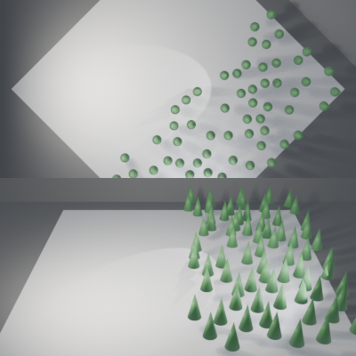

# CH05.04 — Tutoriels pas à pas

Ouvrez `STARTER_FILES/ch05_04_distribution_starter.blend` : `GEO_Field` avec un arbre `GN_Field` qui contient la Grid (10 × 10 m, 11 × 11 sommets) reliée à la sortie, et, à part, la chaîne de l'arbre (Cone → Transform → Set Material) non utilisée. Sauvegardez sous `ch05_04_distribution_starter_<prenom>_v001.blend`.

## Tutoriel 1 — Distribuer (20 min)
Ajoutez Distribute Points on Faces ; Mesh ← Grid. Méthode **Poisson Disk** ; Distance Min 0,5 ; Density Max 3 ; Seed 0.

## Tutoriel 2 — Le masque (20 min)
Position → Separate XYZ [X] → Math (Greater Than, 0) → Density Factor. Spreadsheet : les points n'existent que pour x > 0.

## Tutoriel 3 — Instancier (15 min)
Instance on Points : Points ← Distribute [Points] ; Instance ← Set Material (arbre) ; Rotation ← Distribute [Rotation].

## Tutoriel 4 — Assembler (15 min)
Join Geometry : le sol (Grid) et les instances ; Set Shade Smooth ; Group Output.

## Tutoriel 5 — Comparer (15 min)
Dupliquez le groupe de nœuds pour cette comparaison. En mode *Random*, le nœud expose *Density* et retire *Distance Min* et *Density Factor*. Rebranchez le masque à *Selection* et comparez les arbres à densité visuelle proche. Revenez au groupe Poisson pour remettre la distance minimale.

## Tutoriel 6 — Vérifier
```powershell
& "C:\Program Files\Blender Foundation\Blender 5.3\blender.exe" -b --factory-startup `
  "STARTER_FILES\ch05_04_distribution_starter_<prenom>_v001.blend" `
  --python-exit-code 1 --python "SCRIPTS\validate_ch05_04.py" -- --exercise distribution --debug
```
Référence : `ch05_04_distribution_reference.png` (de face et du dessus).

Remarque d'honnêteté : la solution est générée par script ; les instances évaluées ont été énumérées et le rendu regardé. Le correcteur a révélé deux erreurs de ma part pendant la construction : les entrées de Distribute dépendent de la méthode (pas de Density Factor en Random) et une distance minimale lue au mauvais indice de la réponse du KDTree (0,00 m au lieu de 0,50 m). Les libellés de l'interface (menu de la méthode, noms exacts des sockets) suivent l'API 5.3 ; non relus dans l'interface.

## Référence à comparer



Repérez l’arrêt de la distribution près de l’axe X = 0 et cherchez une paire de points voisins pour contrôler la distance.

## Variante de contrôle

Affichez temporairement le masque comme couleur ou utilisez une sélection de contrôle. Placez un objet témoin au centre de la zone interdite et gardez la graine fixe. Inversez le masque puis restaurez-le. **Preuve** Le diagnostic sépare un masque inversé d’une densité globale trop forte.
