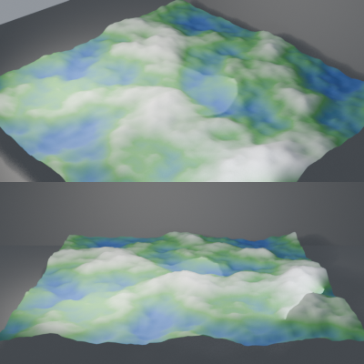

# CH05.05 — Tutoriels pas à pas

Ouvrez `STARTER_FILES/ch05_05_attributes_starter.blend` : `GEO_Terrain` (arbre `GN_Terrain` : Grid 100 × 100 → Set Position (bruit) → Set Shade Smooth → Set Material) et le matériau `MAT_Height` gris uni. Sauvegardez sous `ch05_05_attributes_starter_<prenom>_v001.blend`.

## Tutoriel 1 — Stocker (25 min)
Après Set Position, ajoutez Store Named Attribute : Data Type **Float**, Domain **Point**, Name **height**. Position → Separate XYZ ; sortie **Z** → Value. Spreadsheet (Vertex) : une colonne `height`.

## Tutoriel 2 — Lire dans le matériau (25 min)
Shader Editor sur `MAT_Height` : ajoutez Attribute (Type **Geometry**, Name **height**), Map Range (From Min −0,5 ; From Max 0,5), Color Ramp (bleu (0,05 ; 0,15 ; 0,45) à 0,25 ; vert (0,12 ; 0,40 ; 0,12) à 0,5 ; blanc à 0,85) → Base Color.

## Tutoriel 3 — Régler (15 min)
Déplacez un stop pour faire descendre la limite de neige. Ensuite testez un nom différent seulement dans l’Attribute du shader. Le matériau doit réagir sans déformer le terrain. Remettez exactement `height` et contrôlez la première et la dernière valeur dans le Spreadsheet.

## Tutoriel 4 — Vérifier
```powershell
& "C:\Program Files\Blender Foundation\Blender 5.3\blender.exe" -b --factory-startup `
  "STARTER_FILES\ch05_05_attributes_starter_<prenom>_v001.blend" `
  --python-exit-code 1 --python "SCRIPTS\validate_ch05_05.py" -- --exercise attributes --debug
```
Référence : `ch05_05_attributes_reference.png`.

Remarque d'honnêteté : la solution est générée par script ; l'attribut a été lu dans la géométrie évaluée et le rendu regardé. Les libellés de l'interface (Data Type, Domain, Name, Attribute…) suivent les propriétés de l'API 5.3 ; non relus dans l'interface.

## Référence à comparer



Vérifiez que le gradient de couleur suit l’altitude plutôt que le cadrage ou la pente locale.

## Variante de contrôle

Testez un attribut sur le domaine où vous le stockez puis comparez une lecture sur une surface après une modification de topologie. Vérifiez nom, type et domaine dans le contexte pertinent. **Preuve** Un cas fonctionne et un cas avec nom ou domaine différent explique le défaut visible dans le matériau.
