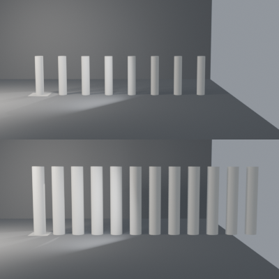

# CH05.06 — Tutoriels pas à pas

Ouvrez `STARTER_FILES/ch05_06_parameters_starter.blend` : `GEO_Row` (un plan) avec un arbre `GN_PillarRow` qui produit déjà 8 piliers, mais dont toutes les valeurs sont écrites dans les nœuds. Sauvegardez sous `ch05_06_parameters_starter_<prenom>_v001.blend`. Espace Geometry Nodes.

## Tutoriel 1 — Créer les entrées (25 min)
Dans le Geometry Node Editor, ouvrez la barre latérale avec `N`, puis l’onglet *Group*. Ajoutez quatre entrées dans l’interface du groupe avant de les relier dans *Group Input*. Height (Float, défaut 2, min 0,2, max 10), Radius (Float, 0,2 ; 0,05 ; 1), Count (Integer, 8 ; 1 ; 50), Spacing (Float, 1,2 ; 0,3 ; 5). Description de chacune.

## Tutoriel 2 — Les panneaux (10 min)
Créez les panneaux « Dimensions » (Height, Radius) et « Layout » (Count, Spacing) et glissez-y les entrées.

## Tutoriel 3 — Brancher (30 min)
Count → Mesh Line [Count] ; Spacing → Combine XYZ [X] (Offset) ; Radius → Cylinder [Radius] ; Height → Cylinder [Depth] et Math (Divide, 2) → Combine XYZ [Z] → Transform [Translation].

## Tutoriel 4 — Essayer (15 min)
Dans le modificateur : Height 3,5 ; Radius 0,3 ; Count 12 ; Spacing 1,0. Les piliers suivent. Comparez avec l'image de référence.

## Tutoriel 5 — Vérifier
```powershell
& "C:\Program Files\Blender Foundation\Blender 5.3\blender.exe" -b --factory-startup `
  "STARTER_FILES\ch05_06_parameters_starter_<prenom>_v001.blend" `
  --python-exit-code 1 --python "SCRIPTS\validate_ch05_06.py" -- --exercise parameters --debug
```
Le correcteur règle lui-même les paramètres et mesure.

Remarque d'honnêteté : la solution est générée par script ; la géométrie évaluée a été mesurée pour les deux réglages et le rendu regardé. La construction a révélé qu'en 5.3 les valeurs du modificateur ne s'écrivent plus `modifier[nom]` mais `modifier.properties.inputs[identifiant]["value"]`. L'emplacement exact des boutons de la colonne Group n'a pas été relu dans l'interface 5.3.

## Référence à comparer



Comparez le nombre de piliers, leur hauteur et l’écart entre leurs axes après modification de paramètres.

## Variante de contrôle

Revenez au modificateur avec les valeurs par défaut. Essayez zéro, la valeur nominale et la limite supérieure de deux paramètres. Donnez à chaque entrée un nom, une unité et un effet vérifiable. **Preuve** Une personne peut obtenir les mêmes trois états sans ouvrir le graphe.
