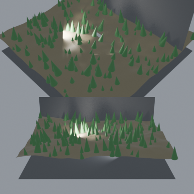

# CH05.07 — Tutoriels pas à pas

Ouvrez `STARTER_FILES/ch05_07_scattering_starter.blend` : `GEO_Forest` avec un arbre `GN_Forest` qui produit déjà le terrain déplacé (Grid 20 × 20 m, bruit, MAT_Ground) mais pas d'arbres, et une interface vide. Sauvegardez sous `ch05_07_scattering_starter_<prenom>_v001.blend`.

## Tutoriel 1 — Interface (15 min)
Créez Seed (Integer, 0, 0–1000), Density (Float, 0,5, 0,05–2), Max Slope (Float, 30, 0–90), avec descriptions.

## Tutoriel 2 — Le masque (25 min)
Normal → Separate XYZ [Z] ; Max Slope → Math (Radians) → Math (Cosine) ; Math (Greater Than) : Z ← Normal Z, seuil ← cosinus. Sortie → Density Factor.

## Tutoriel 3 — Distribuer (15 min)
Distribute Points on Faces (Poisson, Distance Min 0,5) sur le terrain déplacé : Density Max ← Density, Seed ← Seed, Density Factor ← masque.

## Tutoriel 4 — Les variantes (30 min)
Trois Cone (Radius Bottom 0,2/0,3/0,4 ; Depth 0,8/1,2/1,8) → Set Material (MAT_Tree) → Geometry to Instance. Instance on Points : Pick Instance coché ; Instance Index ← Random Value (Integer 0–2) ; Rotation ← Distribute [Rotation] ; Scale ← Random Value (Float 0,8–1,2).

## Tutoriel 5 — Assembler (10 min)
Join Geometry : terrain, instances et géométrie d'entrée → Group Output.

## Tutoriel 6 — Essayer
Fixez *Seed* et *Density*, puis comparez des pentes maximales de 10° et 45°. Plus le seuil est bas, moins de faces inclinées sont éligibles. La distance de Poisson peut limiter la densité obtenue. Remettez 30°, puis changez seulement *Seed* pour comparer la répartition.

## Tutoriel 7 — Vérifier
```powershell
& "C:\Program Files\Blender Foundation\Blender 5.3\blender.exe" -b --factory-startup `
  "STARTER_FILES\ch05_07_scattering_starter_<prenom>_v001.blend" `
  --python-exit-code 1 --python "SCRIPTS\validate_ch05_07.py" -- --exercise scattering --debug
```
Référence : `ch05_07_scattering_reference.png`.

Remarque d'honnêteté : la solution est générée par script ; le correcteur règle les paramètres et mesure les instances évaluées (par lancer de rayons sur le terrain évalué). Mes premières versions faisaient flotter les arbres (j'avais translaté les cônes comme des cylindres) : le correcteur l'a révélé quand j'ai ajouté la mesure de la base ; la mesure par `bound_box` s'est aussi montrée peu fiable pour les instances (j'ai utilisé les sommets de la géométrie instanciée). Les libellés de l'interface graphique n'ont pas été relus.

## Référence à comparer



Repérez une pente peu peuplée et une zone plus plate. Revenez à l’angle de seuil pour expliquer la différence.

## Variante de contrôle

Comparez deux distributions sous le même cadre et fixez la graine. Augmentez d’abord la densité globale, puis réduisez la densité dans le masque. **Preuve** Le sentier reste libre et vous expliquez comment densité, choix de collection et échelle des instances changent le budget.
