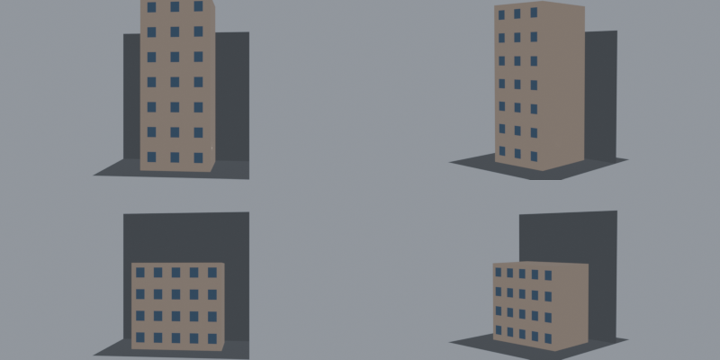

# CH05.08 — Tutoriels pas à pas

Ouvrez `STARTER_FILES/ch05_08_architecture_starter.blend` : `GEO_Building` avec un arbre `GN_Building` qui produit déjà un immeuble de 4 étages × 5 travées, mais avec des valeurs en dur et sans interface. Sauvegardez sous `ch05_08_architecture_starter_<prenom>_v001.blend`.

## Tutoriel 1 — L'interface (20 min)
Entrées : Floors (Integer 4, 1–10), Bays (Integer 5, 1–12), Floor Height (Float 3, 2,5–4), Bay Width (Float 2,5, 1,5–4), Depth (Float 8, 4–15), avec descriptions.

## Tutoriel 2 — Le corps (30 min)
Math : largeur = Bays × Bay Width ; hauteur = Floors × Floor Height. Combine XYZ (X, Y = Depth, Z) → Size du Cube. Transform : Translation z = hauteur ÷ 2.

## Tutoriel 3 — La façade (45 min)
Grid : Vertices X ← Bays, Vertices Y ← Floors ; Size X ← (Bays − 1) × Bay Width ; Size Y ← (Floors − 1) × Floor Height. Transform : Rotation X 90°, Translation y = −Depth ÷ 2, z = Size Y ÷ 2 + 0,55 × Floor Height. Reliez la grille transformée à *Points* de *Instance on Points* et la fenêtre à *Instance*. Testez aussi une travée avec `Bays = 1`. La largeur de la grille de points devient nulle et les fenêtres forment une seule colonne, centrée.

## Tutoriel 4 — Assembler et essayer (20 min)
Join Geometry : corps, instances, entrée. Dans le modificateur : Floors 7, Bays 3, Floor Height 3,4, Bay Width 3,2, Depth 10.

## Tutoriel 5 — Vérifier
```powershell
& "C:\Program Files\Blender Foundation\Blender 5.3\blender.exe" -b --factory-startup `
  "STARTER_FILES\ch05_08_architecture_starter_<prenom>_v001.blend" `
  --python-exit-code 1 --python "SCRIPTS\validate_ch05_08.py" -- --exercise architecture --debug
```
Référence : `ch05_08_architecture_reference.png`.

Remarque d'honnêteté : la solution est générée par script ; les deux réglages sont mesurés sur la géométrie évaluée et rendus ; le cadrage a été corrigé deux fois (bâtiments coupés). Les libellés de l'interface graphique n'ont pas été relus.

## Référence à comparer



Comptez les colonnes et les rangées. Contrôlez que les fenêtres extrêmes gardent une marge par rapport au bord.

## Variante de contrôle

Fabriquez deux variantes de la même construction avec une seule entrée différente. Vérifiez la continuité des niveaux au bord du modèle. **Preuve** Deux vues en élévation et le nombre de répétitions confirment que la règle du bâtiment tient à une autre dimension.
