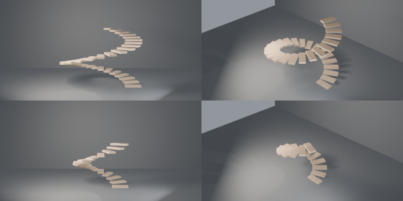

# CH05.09 — Tutoriels pas à pas

Ouvrez `STARTER_FILES/ch05_09_loops_starter.blend` : `GEO_Spiral` avec un arbre `GN_Spiral` qui produit UNE marche. Sauvegardez sous `ch05_09_loops_starter_<prenom>_v001.blend`.

## Tutoriel 1 — L'interface (15 min)
Steps (Integer 16, 3–60), Angle (Float 22,5, 5–45), Rise (0,18 ; 0,05–0,5), Radius (1,2 ; 0,5–3), avec descriptions.

## Tutoriel 2 — La zone (20 min)
Ajoutez une Repeat Zone (Repeat Input et Repeat Output appariés). Iterations ← Steps. Laissez la géométrie de départ vide.

## Tutoriel 3 — La marche (30 min)
Dans la zone : Cube (1,0 × 0,4 × 0,1) → Transform (Translation x ← Radius) → Transform (Rotation z = Iteration × radians(Angle) ; Translation z = 0,05 + Iteration × Rise).

## Tutoriel 4 — Accumuler (15 min)
Join Geometry : géométrie de l'itération précédente (sortie du Repeat Input) + la nouvelle marche → entrée du Repeat Output. Set Material → Group Output.

## Tutoriel 5 — Essayer
Réglez *Steps* à 30, *Angle* à 15°, *Rise* à 0,12 et *Radius* à 2. La première marche occupe l’itération 0. Vérifiez la dernière à l’itération 29 et distinguez le rayon de l’escalier de la largeur du cube utilisé pour chaque marche.

## Tutoriel 6 — Vérifier
```powershell
& "C:\Program Files\Blender Foundation\Blender 5.3\blender.exe" -b --factory-startup `
  "STARTER_FILES\ch05_09_loops_starter_<prenom>_v001.blend" `
  --python-exit-code 1 --python "SCRIPTS\validate_ch05_09.py" -- --exercise loops --debug
```
Référence : `ch05_09_loops_reference.png`.

Remarque d'honnêteté : la solution est générée par script ; les deux réglages sont mesurés (composantes connexes) et rendus. Les zones Simulation et For Each Element n'ont été que créées (existence des nœuds), pas testées dans un exemple. L'emplacement exact de la Repeat Zone dans le menu Add n'a pas été relu.

## Référence à comparer



Suivez une révolution en partant de la première marche. Comparez l’angle entre deux marches et la hauteur gagnée.

## Variante de contrôle

Essayez zéro puis un nombre impair d’itérations sur une copie et notez ce qui traverse la Repeat Zone. Comparez la sortie au résultat après une itération. **Preuve** Expliquez la valeur initiale, la transformation répétée et le résultat attendu sans extrapoler à une autre zone.
