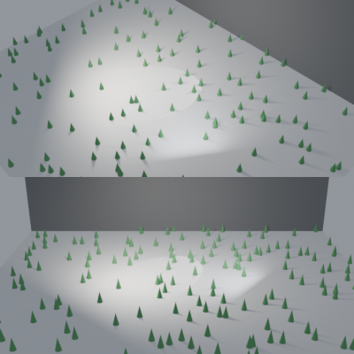

# CH05.10 — Tutoriels pas à pas

Ouvrez `STARTER_FILES/ch05_10_tools_starter.blend` : `GEO_Base` (grille 20 × 20 m) avec l'arbre `GN_ScatterCones` : il disperse des cônes de 64 côtés, réalise les instances, a une Density sans borne (max 1000) et n'est ni modificateur ni asset. Sauvegardez sous `ch05_10_tools_starter_<prenom>_v001.blend` (dans un dossier de travail : le fichier de catalogues s'y écrira).

## Tutoriel 1 — Mesurer (15 min)
À densité par défaut, notez les 13 116 sommets évalués. Comparez ensuite à *Density = 5* sur une copie. Après retrait de *Realize Instances*, relevez ensemble le nombre de sommets du sol et le nombre d’instances, puis comparez l’aspect au même cadrage.

## Tutoriel 2 — Alléger (30 min)
Cone : Vertices 8. Supprimez Realize Instances : reliez Instance on Points [Instances] à Join Geometry. Density : min 0,05 ; max 5 ; défaut 0,5 dans l'interface.

## Tutoriel 3 — En faire un modificateur (10 min)
Options de l'arbre : activez **Modifier**. Vérifiez que Group Input [Geometry] est relié à Join Geometry.

## Tutoriel 4 — Publier (30 min)
Marquez l'arbre comme asset (Mark as Asset) ; description, auteur, licence ; tags « scatter » et « instances » ; catalogue « Tools/Scatter » (Asset Browser, enregistrer : Blender écrit `blender_assets.cats.txt`).

## Tutoriel 5 — Vérifier
```powershell
& "C:\Program Files\Blender Foundation\Blender 5.3\blender.exe" -b --factory-startup `
  "STARTER_FILES\ch05_10_tools_starter_<prenom>_v001.blend" `
  --python-exit-code 1 --python "SCRIPTS\validate_ch05_10.py" -- --exercise tools --debug
```
Le fichier `blender_assets.cats.txt` doit se trouver dans le même dossier que votre .blend.

Remarque d'honnêteté : la solution est générée par script ; les budgets ont été mesurés sur la géométrie évaluée ; le rendu a été regardé (cônes verts sur la grille). Une première version du correcteur contenait un contrôle de temps d'évaluation que j'ai retiré : il donnait 0,001 s même pour 400 001 instances (évaluation paresseuse). Ni l'apparition dans l'Asset Browser ni l'emplacement exact des options (Modifier, Mark as Asset) n'ont été vérifiés dans l'interface 5.3.

## Référence à comparer



Comparez l’aspect avant et après optimisation au même cadrage. Relevez aussi le nombre d’instances et les sommets du prototype.

## Variante de contrôle

Prenez une mesure à faible et forte densité au même cadrage. Consignez séparément objets de scène, instances et géométrie évaluée. Comparez les parties qui n’ont pas besoin d’être réalisées. **Preuve** Un choix d’optimisation trouve un gain mesurable et garde la sortie conforme au contexte d’usage.
