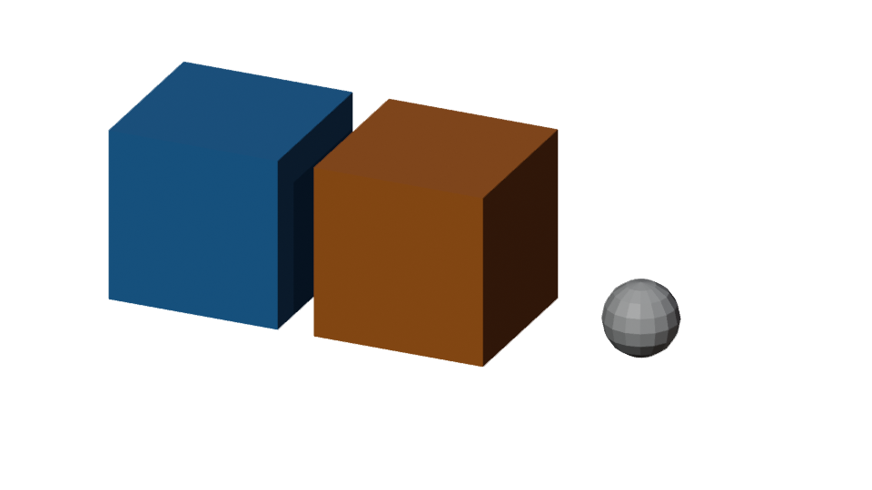

# CH13.02 — Solutions

<!-- QUIZ_ANSWERS_START -->
## Réponses du quiz

| Q | Réponse | Explication |
|---|---|---|
| Q1 | **a** — bpy.data | Le dictionnaire des objets permet un accès par nom. |
| Q2 | **b** — None | Vérifiez le résultat avant de lire ses attributs. |
| Q3 | — | Par l’objet. Deux objets liés peuvent occuper des positions différentes. |
| Q4 | **a** — Copie le maillage | Réaffectez la copie à b.data pour rendre B indépendant. |
| Q5 | — | Oui. Les slots du maillage copié peuvent pointer vers le même datablock matériau. |
| Q6 | **a** — poll() | poll() répond avant l’exécution de l’opérateur. |
| Q7 | **c** — Un ensemble de statuts | Un opérateur renvoie par exemple un ensemble contenant FINISHED. |
| Q8 | — | L’ajout la rend active. Une autre action peut ensuite faire changer l’objet actif. |
| Q9 | **b** — Non | Réglez explicitement view_layer.objects.active si votre opération l’exige. |
| Q10 | — | Il reste ainsi accessible dans la scène au cours du déplacement. |
<!-- QUIZ_ANSWERS_END -->

## Résultat attendu

Dans [la scène corrigée](COMPLETED_EXAMPLES/ch13_02_bpy_solution.blend), A reste bleue, B devient orange et le repère s’ajoute à droite. La valeur de `a.data == b.data` passe de `True` à `False`. L’objet actif après l’ajout est le repère. Il faut sélectionner B et lui rendre l’état actif avant de sauvegarder.

| Contre-exemple | Contrôle qui doit échouer |
|---|---|
| Maillage partagé | Indépendance des données et conservation du bleu de A |
| Repère absent | Présence, position et collection |
| Repère trop haut | Position |
| Mauvais objet actif | Sélection finale |

Le correcteur inspecte la scène enregistrée. Vérifiez votre compréhension en expliquant puis en refaisant la variante autonome depuis un starter neuf.
