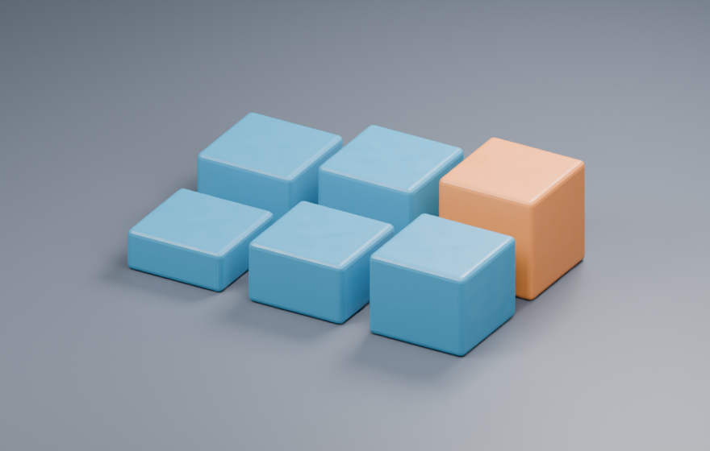

# CH13.03 — Génération d’objets et matériaux

**Pré-requis** CH13.01 et CH13.02. Comptez 2 h 30 pour les deux leçons et 30 à 45 min pour la variante.

Vous fabriquez un présentoir de six échantillons de céramique en écrivant un script dans le Text Editor de Blender 5.3. Les hauteurs changent d’un bloc à l’autre, les arêtes accrochent la lumière et un bloc ocre sert de repère dans la grille.



1. Suivez les [deux leçons](LESSON.md) avec la [théorie](THEORY.md) et le [tutoriel](TUTORIAL.md).
2. Ouvrez le [studio de départ](STARTER_FILES/ch13_03_presentoir_starter.blend) et faites les [exercices](EXERCISES.md) dans Blender.
3. Passez le [quiz](QUIZ.md) et comparez vos réponses au [corrigé](SOLUTIONS.md). En cas de blocage, consultez le [dépannage](TROUBLESHOOTING.md).

## Valider son travail

Livrez une copie du fichier de départ avec le script dans un bloc de texte et le présentoir visible. Le correcteur inspecte la scène enregistrée. Il vous reste à montrer que le script recrée cette scène dans une copie propre du starter, puis à expliquer le chemin du bruit vers la rugosité.

Depuis le dossier du chapitre, adaptez le nom du fichier à votre livraison.

```powershell
& "C:\Program Files\Blender Foundation\Blender 5.3\blender.exe" -b --factory-startup "STARTER_FILES/ch13_03_presentoir_prenom_v001.blend" --python-exit-code 1 --python "SCRIPTS/validate_ch13_03.py" -- --exercise presentoir
```

**Jalon de passage** Exercice 2 validé, quiz ≥ 8/10 et script rejoué sur une copie propre. Gardez le fichier pour la suite sur les collections, les caméras et les rendus.

[Solution Blender](COMPLETED_EXAMPLES/ch13_03_presentoir_solution.blend) · [Script de référence](SCRIPTS/generer_presentoir.py) · [Ressources](RESOURCES.md)

[Suite · CH13.04 Collections, caméras et rendus](../CH13_04_PLAN_SETUP/README.md)
