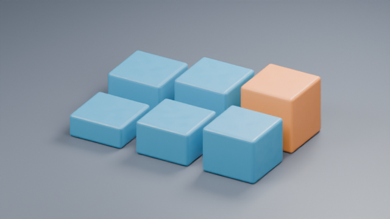
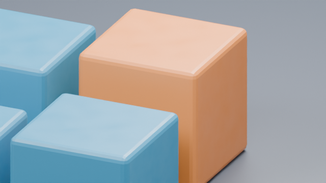

# Atelier guidé — Collections, caméras et rendus

Dans Blender, ouvrez le corrigé de CH13.03. Dans Scripting → Text Editor, ouvrez le script, puis lancez **Run Script**. Enregistrez le résultat sous un nouveau nom. Les commandes Numpad 0 et F12 ouvrent la vue caméra et lancent le rendu.

## 1. Origine du cadre

Ouvrez le présentoir CH13.03 et dupliquez le fichier. Dans le script, comparez les deux couples position et cible avant de lancer Run Script.

**Pourquoi** Les vecteurs position et cible règlent séparément le placement et l’axe optique.

**Contrôle** Les deux caméras se trouvent dans COL_Plans et visent le présentoir.

## 2. Raccord de caméra

Jouez les images 1, 24, 25 et 48 et vérifiez le nom de la caméra active dans la vue caméra.

**Pourquoi** Un marqueur lié à une caméra prend effet à son image, puis reste actif jusqu’au marqueur suivant.

**Contrôle** PLAN_010 est actif en 1 et 24, PLAN_020 en 25 et 48.

## 3. Réglage de livraison

Vérifiez 640 × 360 à 100 %, 24 i/s et PNG. Faites un rendu de chacune des deux images de coupe.

**Pourquoi** Des réglages communs évitent des rapports d’image ou des cadences incohérentes.

**Contrôle** Deux PNG cadrés différemment, aux images 1 et 25.

## Vérification sur une variante

Rendez les images 24 et 25. Dans le tableau, inscrivez pour chacune caméra effective, échelle et information lue. Recadrez le détail en gardant sa cible et comparez avec une variante qui change seulement la cible.
