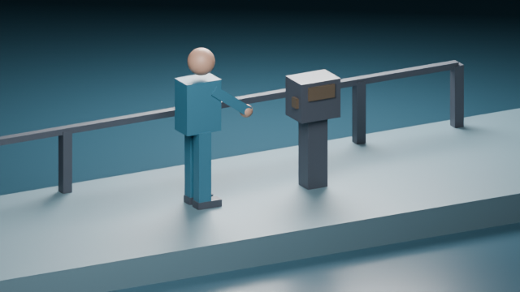
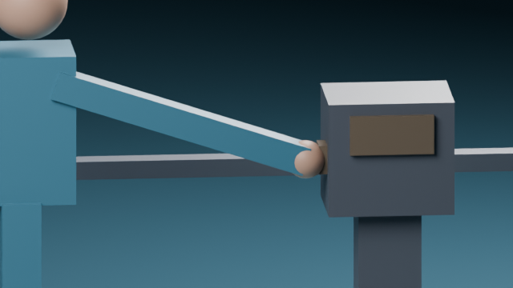
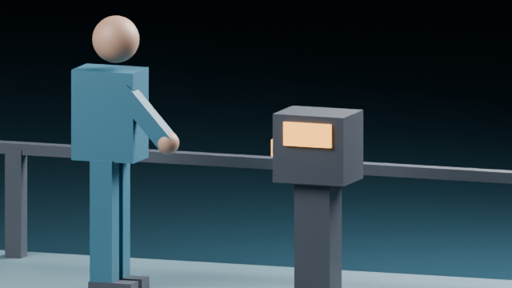

# Atelier guidé — Storyboard et animatique

Avec 24 i/s, refaites la planche Grease Pencil puis comparez la cadence à [l’animatique VSE de référence](../ASSETS_ATELIERS/sur_le_quai_animatique.blend) et à son [MP4](../ASSETS_ATELIERS/sur_le_quai_animatique_0001-0360.mp4). Les vignettes de référence sont des rendus de layout fixes. Elles permettent de contrôler le montage avant l’animation complète.

## 1. Panneaux

Dans Blender, tracez quai, silhouette, balise et direction du regard sur trois panneaux Grease Pencil. Numérotez 010, 020 et 030.

**Pourquoi** Le storyboard fixe la hiérarchie visuelle et la continuité avant l’animation.

**Contrôle** Les silhouettes et l’objet restent lisibles en miniature.

## 2. Assemblage

Utilisez le VSE pour couvrir 1–120, 121–216, 217–360 à 24 i/s. Posez les marqueurs S010, S020 et S030 au début des plans.

**Pourquoi** Les plages sont inclusives dans la feuille de plans. Le montage doit couvrir chaque image une seule fois hors transitions prévues.

**Contrôle** Aucun trou entre les plans et le dernier cadre est 360.

## 3. Écoute

Ajoutez un clic de signal original ou autorisé au début du dernier plan. Regardez la séquence avec puis sans son.

**Pourquoi** Le son guide l’attention et peut aussi masquer une faiblesse visuelle.

**Contrôle** La bascule est intelligible sans son, puis renforcée par le clic.

## Vérification sur une variante

Faites avancer la coupe S020/S030 de 12 images. Gardez 360 images et replacez le clic sur le premier cadre du plan final. Faites lire les deux versions à un lecteur qui connaît uniquement la situation initiale.
