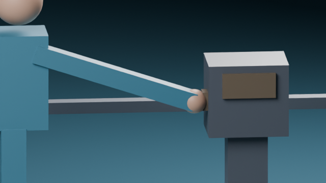

# Atelier guidé — Fabrication

Ouvrez la [scène de layout](../ASSETS_ATELIERS/sur_le_quai_layout.blend), sauvegardez une copie et regardez le contact en [S020](../ASSETS_ATELIERS/S020.png). Les volumes sont simplifiés pour la mise en place. Remplacez la silhouette si vous poursuivez vers le film complet.

## 1. Layout

Bloquez grossièrement le quai, la silhouette et la balise. Cadrez S020 et marquez le début du geste puis le contact.

**Pourquoi** Le layout règle l’échelle, l’axe et le champ de la caméra avant d’investir dans le détail.

**Contrôle** La main et la balise sont dans le champ aux deux moments critiques.

## 2. Blocking

À l’aide de clés Constant, posez attente, action puis retrait. Comparez les silhouettes et gardez une version du blocking.

**Pourquoi** Les poses clés permettent de valider la narration avant le travail d’interpolation.

**Contrôle** Trois poses reconnaissables et une capture de contrôle.

## 3. Animation et rendu

Dupliquez le fichier, passez aux courbes continues et contrôlez la vitesse de la main ainsi que le contact. Réglez la lumière puis rendez trois images de contrôle.

**Pourquoi** L’animation et l’éclairage se vérifient sur des images représentatives avant le calcul complet.

**Contrôle** Au moins une pose avant le contact, une au contact et une après sont rendues.

## Vérification sur une variante

Dans S020, identifiez une pose avant contact et la pose de contact. Contrôlez deux images intermédiaires pendant la montée de la main. Corrigez un trajet qui traverse la balise, puis revenez à la vue caméra pour vérifier l’intention.
