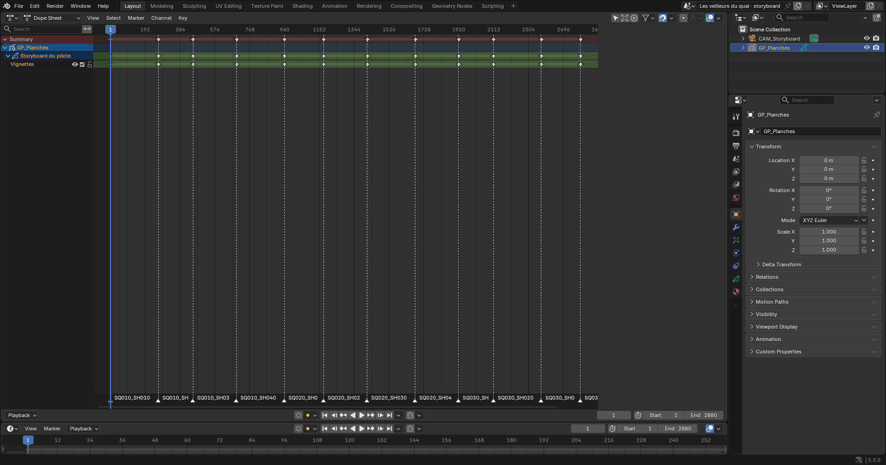

# Atelier guidé — Séquences et plans

Téléchargez le CSV et utilisez le [projet de démarrage du pilote](../ASSETS_ATELIERS/pilote_timeline.blend). Pour vérifier le découpage à la ligne de commande, depuis le dossier de ressources lancez `python controle_pipeline.py plans`. Reprenez l’animatique Grease Pencil du [chapitre CH18.14](../../18_GREASE_PENCIL/CH18_14_ANIMATIC/README.md). Le starter contient des marqueurs, aucun cadre fini.

## 1. Décrire les séquences

Repérez les trois étapes du [pilote](../ASSETS_ATELIERS/PILOTE.md). Pour chaque plan, indiquez information, action, décor et responsable. Gardez l’identifiant du plan indépendant de son ordre.

**Pourquoi** Un identifiant stable conserve l’historique quand une coupe change. Une plage de montage peut changer à chaque version.

**Contrôle** Douze identifiants uniques, trois séquences et un motif de coupe par plan.

## 2. Conformer la timeline

Ouvrez un VSE à 24 i/s. Posez les marqueurs aux débuts du CSV. Bloquez les temps avec Grease Pencil et jouez le montage. Relisez les bornes inclusives.

**Pourquoi** La durée d’un plan vaut fin moins début plus un dans la feuille. Deux plages adjacentes s’enchaînent sans image noire.

**Contrôle** La timeline du pilote couvre 1–2880. SQ020_SH010 commence à 961 et SQ030_SH010 à 1921.

## 3. Réviser et suivre

Décalez la coupe avant SQ020_SH030 de 24 images. Raccourcissez le plan suivant d’autant. Notez la raison et conservez les ID et la version précédente.

**Pourquoi** Le suivi doit distinguer détail du plan, changement de montage et statut d’approbation.

**Contrôle** Le total reste 2880 images et la note identifie deux plans affectés.

## Vérification sur une variante

Effectuez ce changement dans une copie CSV et dans la timeline. Vérifiez le contrôle des trous et chevauchements. Consignez les deux versions et une raison de garder l’identifiant stable.
