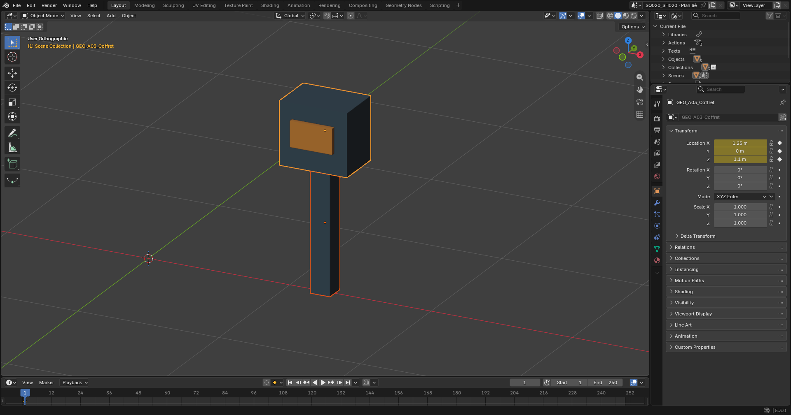

# Atelier guidé — Gestion des assets

Placez le plan et les deux bibliothèques ensemble dans un dossier d’essai. Ouvrez le plan, affichez les bibliothèques dans l’Outliner en mode Blender File et comparez l’emplacement de GEO_A03_Coffret avec sa valeur en source. [Version v002](../ASSETS_ATELIERS/A03_Balise_v002.blend).

## 1. Publier l’asset

Ouvrez la bibliothèque. Inspectez COL_A03_Balise, l’origine et les unités. Comparez aux dépendances de la [feuille](../ASSETS_ATELIERS/assets_pilote.csv).

**Pourquoi** Une bibliothèque publiée donne une version identifiable et une hiérarchie stable à tous les plans.

**Contrôle** La collection source est identifiable et ses pièces utilisent des noms distincts.

## 2. Lier et adapter

Dans un .blend vide, faites File → Link, ouvrez Collection et choisissez COL_A03_Balise. Utilisez Make Library Override dans l’Outliner pour la déplacer dans le plan.

**Pourquoi** Link conserve la dépendance au fichier source. Un override autorise une adaptation locale sur la hiérarchie liée.

**Contrôle** Le plan conserve la bibliothèque et la position du modèle diffère du placement source.

## 3. Réviser sans écraser

Sauvegardez une copie versionnée. Comparez v001 et v002, puis testez le changement de bibliothèque dans une branche de plan. Inspectez toujours la hiérarchie et le déplacement local après reload.

**Pourquoi** Une modification du contenu ou des noms peut nécessiter une resynchronisation. Une version publiée facilite le retour arrière.

**Contrôle** Une table indique source, version testée, propriétés locales et décision par plan.

## Vérification sur une variante

Rouvrez une copie composée du plan et de ses deux bibliothèques dans un autre dossier. Vérifiez l’origine du coffret source et la position locale du plan. Comparez aussi la fenêtre v001 et v002.
