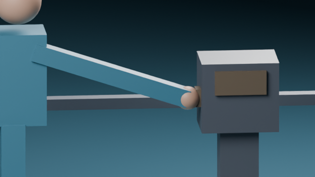

# Atelier guidé — Équipes et départements

Répétez la revue avec deux personnes ou distribuez trois rôles à des lecteurs. Regardez les vignettes [S010](../../15_SHORT_FILMS/ASSETS_ATELIERS/S010.png), [S020](../../15_SHORT_FILMS/ASSETS_ATELIERS/S020.png) et [S030](../../15_SHORT_FILMS/ASSETS_ATELIERS/S030.png) avant de consulter les notes fictives du pilote.

## 1. Répartir

Dessinez le circuit auteur du plan, lead, supervision, réalisation et production. Désignez un seul décideur par type de note.

**Pourquoi** Plusieurs métiers peuvent contribuer. Une décision unique et attribuée évite des demandes opposées sur le même plan.

**Contrôle** Chaque note possède auteur, responsable, décideur et échéance.

## 2. Faire une revue

Regardez les vignettes du quai sans commentaire, puis avec le brief. Pour trois notes, indiquez plan, version, image précise, effet observé et priorité.

**Pourquoi** Une note exploitable distingue observation et intention. Dire « améliorer » laisse le critère indéterminé.

**Contrôle** Trois notes peuvent être comprises et testées par un artiste absent de la revue.

## 3. Fermer la boucle

Jouez la version suivante de deux plans ou comparez les preuves du corrigé. Marquez accepté, repris ou reporté avec motif.

**Pourquoi** Une note se ferme sur une preuve. Une note reportée garde sa place dans l’historique.

**Contrôle** La décision et la preuve sont liées à la même version revue.

## Vérification sur une variante

Prenez N-014 et N-016. Produisez pour chacune une note de validation avec preuve et référence. Pour N-016, ajoutez le nom d’un second plan qui consomme la même version et vérifiez-le avant de fermer la note.
